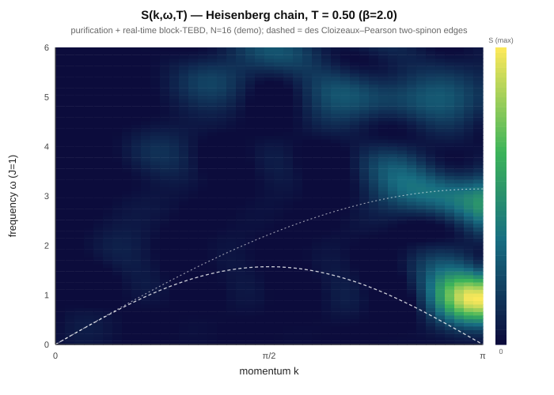
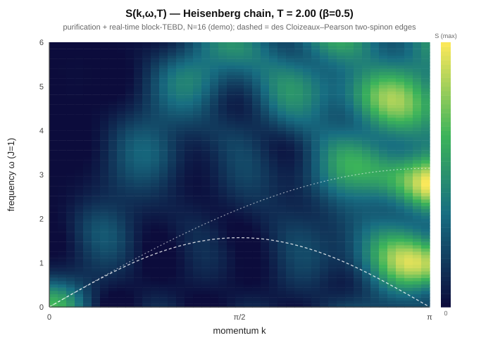
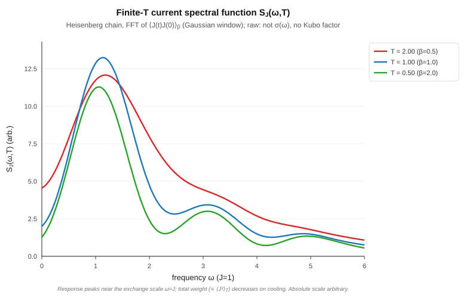
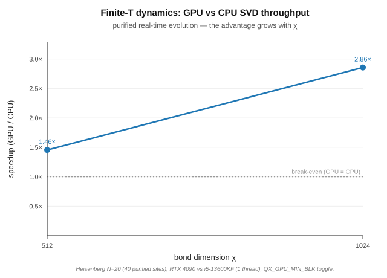

# Finite-temperature spectroscopy (KF2)

QuantX computes **finite-temperature dynamical response functions** of spin chains
by ancilla purification + real-time block-TEBD on the GPU-accelerated block-sparse
engine — the same engine that produces the T=0 dynamics, with no new symmetry code.
The pipeline goes from a Hamiltonian to the experimentally relevant observables:

| observable | what it is | routine |
|---|---|---|
| `E(T)`, `⟨Z_cZ_j⟩`, `χ_zz(T)` | static thermodynamics | `run_thermal_blocks` (F0) |
| **`S(k,ω,T)`** | dynamical structure factor | `run_spectral_thermal_blocks` (F1) |
| **`σ(ω,T)`** | optical / spin conductivity | `run_conductivity_thermal_blocks` (F2) |

All three are XXZ-general (anisotropy Δ) and validated against exact
diagonalization at every temperature.

## How it works

The Gibbs state `ρ(β) = e^{−βH}/Z` is represented as a **pure state**
`|ψ(β)⟩ = e^{−βH/2}|ψ0⟩` on an **interleaved 2N chain** — physical sites at even
positions, ancillas at odd. `|ψ0⟩` is a product of singlet Bell pairs (the β=0
infinite-temperature state); cooling is imaginary-time TEBD with **swap-and-carry**
gates that ferry physical neighbours together. This keeps the engine's `d=2` /
±1-charge-shift block structure exactly intact — zero engine changes (see
[finite_temperature_plan.md](finite_temperature_plan.md) for the design pivot from
the originally-planned `d=4` composite site).

Dynamical correlators `C(t;T) = ⟨A(t) B⟩_β` cool to `|ψ(β)⟩`, apply the source
(`σ^z_{l0}` for `S(k,ω,T)`, the total current `J` for `σ(ω,T)`), and real-time
evolve **both** the unsourced and sourced states — the finite-T bra is not
stationary, unlike T=0. The **Karrasch–Bardarson–Moore backward-ancilla
disentangler** cancels the real-time entanglement growth of the unsourced state (a
true unitary gauge, exact to ~1e-13; a compute win — see
[disentangler figure](disentangler_bond_growth.svg)).

## Validation

Every routine is checked against dense ED at small N (the exact thermal trace /
Lehmann representation), on three SVD backends (Eigen-CPU, cuSOLVER-GPU, LAPACK):

| test | reference | worst error |
|---|---|---|
| `qx_thermal_blocks_test` | `Tr[O e^{−βH}]/Z`, N=8 | β=0 exact; finite-β ~1e-3 (Trotter) |
| `qx_thermal_spectral_test` | ED Lehmann `S(k,ω,T)`, N=6 | ~6e-3 / 8e-3 (β=0.5 / 4) |
| `qx_thermal_transport_test` | ED Lehmann `σ(ω,T)`, N=6 | ~4e-3 / 1.2e-2 (β=0.5 / 2) |

The disentangler-invariance check (`|C_on − C_off| ~ 1e-13`) is the proof that the
ancilla-backward gauge is exact, not an approximation.

## Spectra

The figures below are space+time FFTs of the emitted correlators (Heisenberg
chain, N=16, χ=512 — demonstration scale; see the caveat). They show the
**temperature dependence** of the response directly.

**Dynamical structure factor `S(k,ω,T)`.** The dashed lines are the des
Cloizeaux–Pearson two-spinon continuum edges `ω = (π/2)|sin k|` and
`ω = π|sin(k/2)|`. Cold (`T = 0.5`) shows a **sharp, bright antiferromagnetic
spinon peak at `k = π`, low ω** — coherent spectral weight pinned to the lower
continuum edge (the brightest cells sit at `k ≈ π, ω ≈ 0.9`, inside the
continuum). Warm (`T = 2`) is **broad and washed out** — thermal incoherence
spreads the weight across the band. That sharp→broad evolution on warming is the
finite-T spectroscopy.

**Current spectral function `∝ σ(ω,T)`** (FFT of `⟨J(t)J(0)⟩_β`; the raw spectral
function, not Kubo-reweighted). The response peaks near the exchange scale
`ω ≈ J`; the total weight (f-sum `∝ ⟨J²⟩_T`) shrinks on cooling.

Generated by `qx_thermal_skw_emit` / `qx_thermal_transport_bench` →
`benchmarks/plot_skw.py` / `benchmarks/plot_conductivity.py` (pure-stdlib SVG, no
numpy). **Caveat:** these are small-N / modest-χ *demonstrations* — a converged
S(k,ω,T) needs larger N (so finite-size revivals fall outside the time window)
and larger χ (so the long-time dynamics is truncation-free). That is exactly the
regime where the GPU large-χ engine pays off; the correlators themselves are
ED-validated (above).

## GPU acceleration — the advantage grows with χ, now at finite T

The block-sparse SVD hot loop fires unchanged on the purified chain, and the
real-time response **saturates the bond dimension to χ_max** within a few steps —
so finite-T dynamics lands directly in the large-χ regime where cuSOLVER beats the
CPU. Timing the purified real-time evolution (Heisenberg N=20, 40 purified sites,
RTX 4090 vs a single i5-13600KF thread, `QX_GPU_MIN_BLK` toggle, identical
`E(β) = −32.618` on both paths):

| χ | GPU | CPU | speedup |
|---|-----|-----|---------|
| 512 | 46.5 s | 67.6 s | **1.46×** |
| 1024 | 90.6 s | 258.7 s | **2.86×** |

The margin **grows with χ** (1.46× → 2.86×), the same property as the T=0 dynamics
([gpu_margin_vs_chi.svg](gpu_margin_vs_chi.svg)) — and here the win at χ=1024 is
*larger* than the T=0 Néel-quench (~2.2×), because the finite-T correlator evolves
two states (a non-stationary bra and the sourced ket), doubling the SVD load. This
is the "bigger problem → bigger advantage" property exactly where finite-T needs
it: low T and long times both push χ up. Benchmark: `qx_thermal_gpu_bench`
(`QX_GPU_MIN_BLK=128` GPU vs `=9999999` CPU) → `benchmarks/plot_gpu_finiteT.py`.
