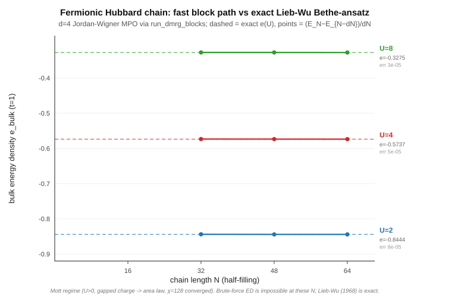
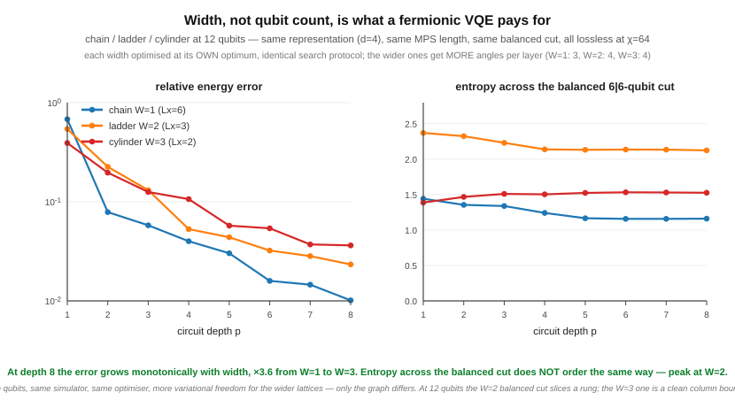
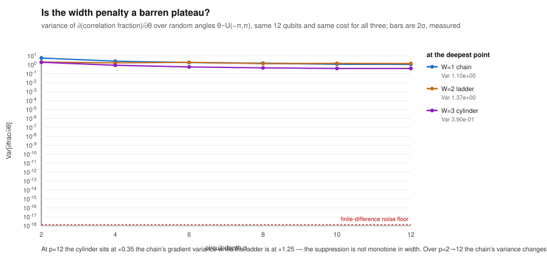
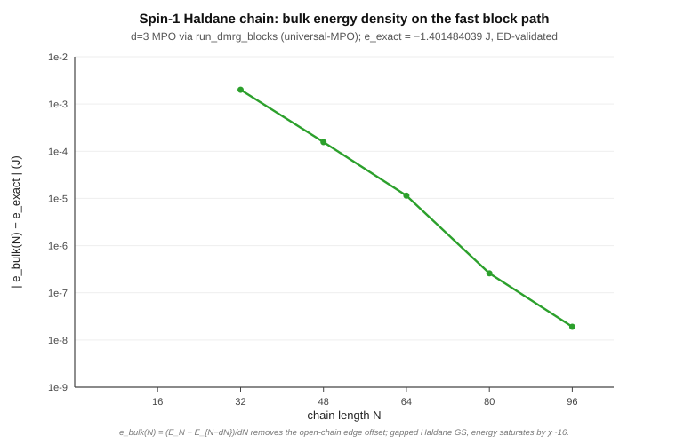
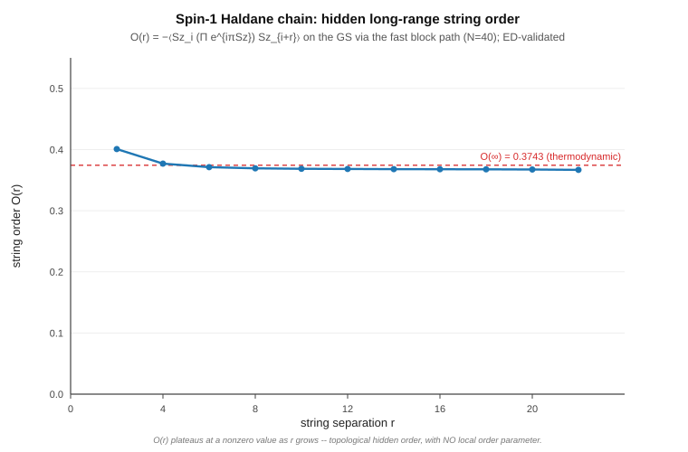
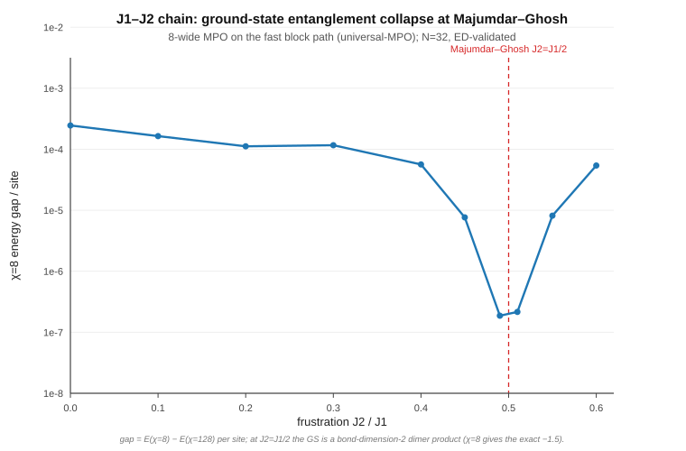
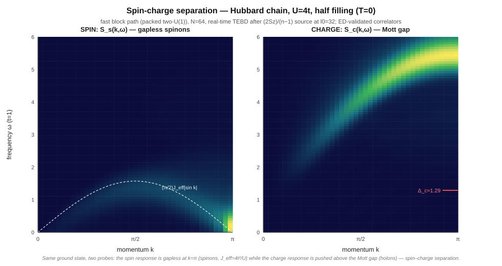
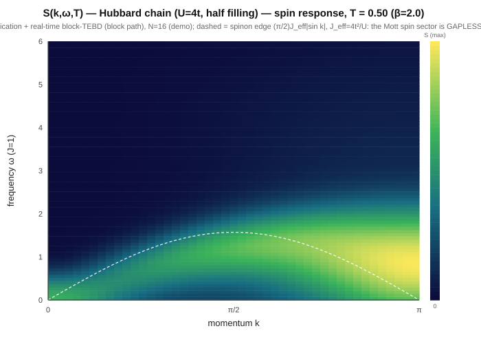
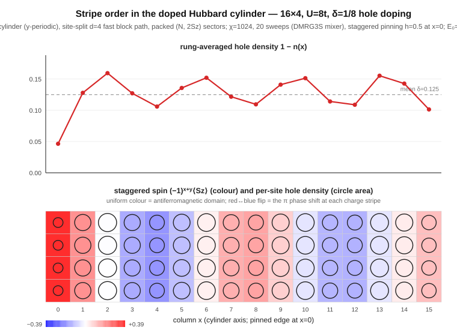
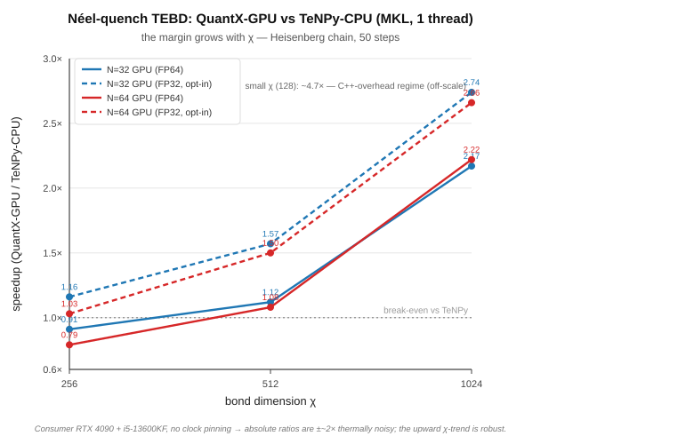

Results
=======

Everything below is produced by code in this repository, and every figure names the data
file it was rendered from. The sections are ordered by how strong the comparison is, and
each one says which kind it is — because "agrees with an exact solution", "agrees with a
published number" and "shows the expected behaviour at this size" are three different
claims and should not be read as one.

**Lossless** below means the bond dimension χ was at or above the full Hilbert-space
bound, so the result carries no truncation error and an agreement figure measures the
method rather than the cutoff.

Against exact answers
---------------------

**The Hubbard chain against the Lieb–Wu integral equations.** The 1D Fermi-Hubbard model
is exactly solvable, so its bulk energy per site is known *analytically* rather than from
another numerical calculation. The engine's bulk energy per site is taken as the
incremental difference (E₆₄ − E₄₈)/16 between its two longest open chains — a finite
difference, not an extrapolation:

.. list-table::
   :header-rows: 1

   * - U/t
     - engine, (E₆₄ − E₄₈)/16
     - Lieb–Wu exact
     - difference
   * - 2
     - −0.84429042
     - −0.84437434
     - 8.4e-5
   * - 4
     - −0.57368361
     - −0.57372937
     - 4.6e-5
   * - 8
     - −0.32750449
     - −0.32753053
     - 2.6e-5

Data: ``docs/hubbard_lieb_wu.csv``. The residual is mainly finite-size error that the
difference does not cancel: the spin excitations are gapless at every U, so the energy of
an open chain carries a 1/N term, and that term shrinks as U grows because the spin
velocity does. Fitting it out of the three longest chains removes most of the residual.

**Ground states against independent exact diagonalisation.** For the XXZ, J1-J2, spin-1
Heisenberg and Fermi-Hubbard chains, and for Hubbard ladders and cylinders where the
fermion signs are physical, the Python API is checked against an exact diagonalisation
written independently of the engine, to **1e-10**. These run in CI
(``python/quantx_engine/tests/test_models_ed.py``).

**Fermionic VQE circuits against a dense state vector.** Hamiltonian Variational Ansatz
circuits are simulated *exactly*: every layer conserves particle number and spin, so the
U(1)×U(1) block structure is an advantage for circuits rather than a restriction. Energy
and entanglement entropies agree with an independent state-vector simulator to **1e-10**
at the sizes below, where χ is at the full Hilbert-space bound — the bound the README
states and CI enforces. The measured residuals are smaller and are tabulated with the width
scan in the documentation; they are not repeated here, so they cannot drift.

*What width costs a fermionic VQE.* Chain, ladder and cylinder at the same 12 qubits, the
same site-split representation, the same balanced cut and the same search protocol — only
the connectivity graph changes. At depth 8 the correlation energy captured falls
98.5 % → 95.7 % → 90.7 % as the lattice widens, and that ordering holds at every depth
from 2 to 12. The wider lattices get **more** parameters per layer (4 against the chain's
3), so a worse energy with more freedom is the stronger form of the result.

Data: ``docs/vqe_width.csv``. The entropy half of this comparison does **not** order by
width, and the figure's own caption says so, because it is generated from the data. At 12
qubits a cut that splits the qubits evenly slices through a ladder rung but falls on a
clean column boundary for the cylinder, so the two are not the same kind of cut. That is a
limitation of the size, not of the measurement.

*Trainability against width.* The same three geometries, now measuring the variance of a
cost gradient over random parameter draws. The cylinder's landscape is flatter than the
chain's by a depth-independent factor: ×0.30–0.35 on the dimensionless cost and
×0.15–0.18 on the raw gradient, at every depth, with a measured 2σ of ±0.05–0.06. The
differentiated generator holds three bonds at every width and a colouring group is a
matching, so the comparison is not a normalisation artefact.

Data: ``docs/vqe_barren.csv``, ``docs/vqe_barren_size.csv``. The instrument is calibrated
before it is used: Richardson extrapolation puts the finite-difference noise floor at
1.7e-9 and every point in this figure sits at least 5.4e8 × above it, which is why the floor is
drawn on the same axes. This figure does **not** show a barren plateau — that term means
exponential decay in system size, and the accompanying size scan cannot establish one in
either direction. The documentation says why at length.

Against published values
------------------------

These are comparisons against numbers from the literature, which are themselves numerical
rather than analytic. That is a weaker kind of check than the section above and is
labelled separately for that reason.

**The spin-1 Heisenberg chain and the Haldane phase.** The gapped Haldane ground state is
the standard hard case for a spin chain. By N = 96 the engine reproduces the energy
density **−1.401484039 J** per site — the accepted DMRG value, White and Huse (1993) — to
about **2e-8**. The string order parameter saturates while the spin-spin correlation
decays exponentially, the two signatures that separate the Haldane phase from a trivial
gapped one.

Data: ``docs/spin1_haldane.csv``, ``docs/spin1_string_order.csv``. Energies here are in
the S·S convention; the J1-J2 figures below use the Pauli convention, where each term is
XX + YY + ZZ and the numbers are four times larger.

Convergence and truncation
--------------------------

**What a low-χ calculation misses, across the J1-J2 chain.** At J2 = J1/2 — the
Majumdar-Ghosh point — the exact ground state is a product of nearest-neighbour dimers, so
it has bond dimension 2 and χ = 8 represents it exactly; its energy is −1.5 per site
(Pauli convention). The scan samples the two points straddling it, J2 = 0.49 and 0.51,
whose energies are −1.50021 — a different J2, not a discrepancy. Away from that point the
frustrated state is
genuinely entangled and χ = 8 under-converges. The figure plots that difference,
E(χ = 8) − E(χ = 128) per site:

.. list-table::
   :header-rows: 1

   * - J2/J1
     - 0
     - 0.45
     - 0.49
     - 0.51
     - 0.55
   * - energy χ = 8 misses, per site
     - 2.5e-4
     - 7.6e-6
     - **1.9e-7**
     - **2.2e-7**
     - 8.2e-6

Data: ``docs/j1j2_dimerization.csv``. The collapse is ×1313 from J2 = 0 to the
points straddling Majumdar-Ghosh. This is a truncation-sensitivity curve, not an order
parameter: it measures how much entanglement the state carries, which is why it bottoms
out exactly where the ground state becomes a bond-dimension-2 product.

Demonstrations
--------------

These run the engine on problems where no exact answer or published number is quoted
here. They show expected physics at a stated size and χ; they are not validations.

**Spin-charge separation in the Hubbard chain, at T = 0.** One electron, two separated
collective excitations: the spin panel is gapless at k = π (the spinon continuum), while
the charge panel opens the Mott gap and pushes the holon continuum up.

Data: ``docs/hubbard_spin_correlator.csv``, ``docs/hubbard_charge_correlator.csv``.

**The dynamical spin structure factor at finite temperature.** Purification carries the
engine to finite T, where it computes dynamical response rather than static energies.
S(k, ω, T) for the Hubbard chain at β = 2, from a 16-site purified chain:

Data: ``docs/skw_hubbard_b2.0.csv``.

**Stripe order in the doped Hubbard model.** On a 16×4 cylinder at U = 8 and 1/8 hole
doping, the engine finds hole-rich rings around the cylinder about every 4 sites, and the
antiferromagnetic order changes sign across each one — the π phase shift that is the
signature of stripe order. This demonstrates the machinery (a doped charge sector, edge
pinning, per-site profiles, 64 sites at χ = 1024); it does not settle the wavelength. At
this doping the favoured stripes are reported to be *filled*, twice as far apart, with
competing wavelengths a few kelvin apart in energy (Zheng et al., Science 358, 1155
(2017)). The half-filled pattern here is one of those close competitors, and separating
them takes a far larger χ.

Data: ``benchmarks/stripes_16x4_chi1024.log``, the run's own output, from which
``benchmarks/plot_stripes.py`` writes ``docs/hubbard_stripes.csv`` and draws the figure.

Performance
-----------

The honest comparison is against a mature library on the same problem, not against the
engine's own CPU path. Against single-threaded TeNPy with MKL, on TEBD at N = 32,
min-of-2 runs:

.. list-table::
   :header-rows: 1

   * - χ
     - 256
     - 512
     - 1024
   * - QuantX (CUDA + OpenBLAS) vs TeNPy (MKL)
     - 0.91×
     - 1.12×
     - **2.17×** (2.74× with FP32)

Data: the values are hard-coded in ``benchmarks/plot_margin_vs_chi.py`` from the
measurements in ``docs/gpu_acceleration_report.md``; there is no CSV for this figure.

The margin grows with χ because that is where the SVD dominates: the bare GPU SVD kernel
is 45× the CPU one at χ = 1024. **Below χ ≈ 512 the engine is at parity or slower**, and
that is reported rather than omitted. At N = 64, χ = 1024 the figure is 2.22× (2.66× FP32),
consistent with the N = 32 measurement. Timings on this machine are thermally noisy, so
the quoted numbers are minima over repeats.

The CUDA path requires a source build. **The published wheels are CPU-only**, so
``pip install quantx-engine`` does not give you these numbers.

How these numbers are kept honest
---------------------------------

Three review rounds on one pull request each found a figure in the prose that no longer
matched the data it came from — stale after a re-run, or mistyped. Remembering to check
did not work, so it is enforced instead:

* ``benchmarks/check_vqe_doc.py`` derives every quoted VQE figure from the committed CSVs
  and asserts the rendered string appears in the documentation. It runs in CI as
  ``qx_vqe_doc_figures``.
* It also asserts the *shape* of the data, not only the digits — that an ordering holds at
  every depth, that a decay rate is not constant, that a committed data row could have
  been produced by the documented command. When a re-run overturns a conclusion, the check
  demands the prose be rewritten rather than the numbers retuned.
* Figure captions are generated from the data files, so a figure states what its numbers
  support even where that contradicts the surrounding text. The width figure does exactly
  that.

The intended failure mode is a loud one: a claim that drifts from its data should break a
test, not survive into a release.
