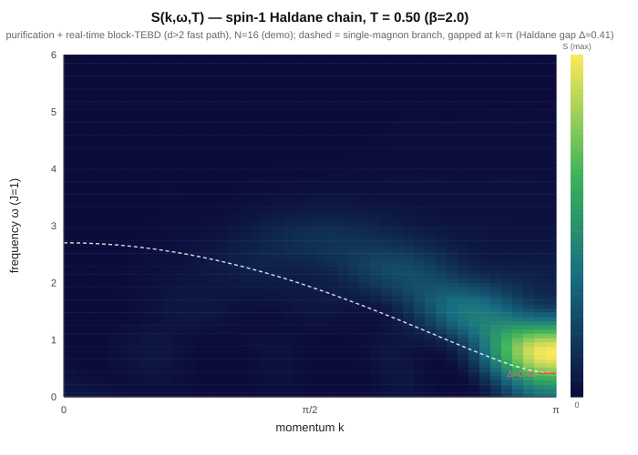
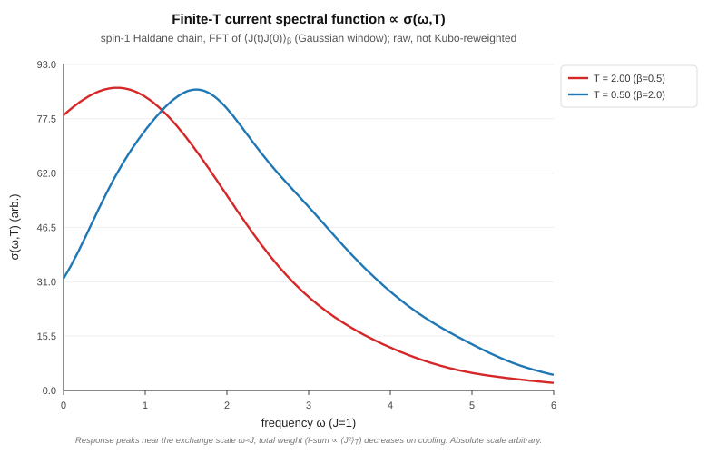

# Universal MPO — any Sz-conserving model on the fast engine

The block-sparse, GPU-accelerated engine was originally hard-wired to the
nearest-neighbour Heisenberg/XXZ bond structure (`HB_DELTA={0,+2,−2,0,0}` baked
into every environment / `H_eff` kernel). The **universal MPO** work makes the
bond structure *data-driven*: the per-bond U(1)/Sz charge is **derived from the
operator MPO itself**, so the same fast engine — DMRG, real-time dynamics,
`S(k,ω)`/`σ(ω)`, the whole finite-temperature stack, the grows-with-χ GPU
acceleration — runs **any Sz-conserving Hamiltonian**, not just XXZ.

## How

`derive_mpo_sym(mpo)` recovers each MPO bond index's Sz charge from the operator
structure alone, propagating `delta[b] = delta[a] + sz(s) − sz(s')` over every
nonzero `W(a,b)(s,s')` and anchoring the vacuum bond at 0; it throws if the MPO
isn't Sz-conserving. The env/`H_eff` kernels then consume that `delta` array in
place of the hard-coded constant. For Heisenberg the derived charges *equal*
`HB_DELTA`, so the rewiring is bit-identical there (the n=32 regression energy is
unchanged to the digit); for a wider MPO it just works.

## Showcase: the frustrated J1–J2 chain

`H = J1 Σ S_i·S_{i+1} + J2 Σ S_i·S_{i+2}` is the textbook frustrated chain — an
**8-wide MPO** (`build_j1j2_mpo`), wider than Heisenberg's 5. It now runs on the
fast block path, matching exact diagonalization to **~1e-13** (`qx_mpo_sym_test`,
N=8 and N=10).

The figure is a pure-energy signature of the physics, computed entirely on the
new path (`qx_j1j2_showcase`, N=32). As `J2/J1 → 0.5` (the **Majumdar–Ghosh
point**) the ground state dimerizes toward a product of nearest-neighbour
singlets — a **bond-dimension-2** state — so its entanglement collapses and a
χ=8 DMRG nearly reaches the converged energy: the χ=8 gap drops **~1300×**
(2.5e-4 → 1.9e-7) approaching MG. Exactly at J2=J1/2, χ=8 returns the **exact
Majumdar–Ghosh dimer energy** E/N = −1.500000.

## Showcase: the spin-1 Haldane chain (arbitrary local dimension)

Phase 1 generalized the *bond* structure; **phase 2 generalizes the *local*
dimension**. The same engine now runs `H = J Σ S_i·S_{i+1}` with the **physical
spin-1 operators** (local dimension d=3, `build_spin1_heisenberg_mpo`) — the
gapped **Haldane phase**, a different universality class from the critical
spin-1/2 chain. It matches exact diagonalization to **~1e-13** (`qx_mpo_sym_test`,
N=4 and N=6, on both the dense and the fast block path).

`qx_spin1_showcase` runs the chain on the fast block path at growing N. The
**incremental bulk energy** `e_bulk(N) = (E_N − E_{N−ΔN})/ΔN` removes the
open-chain edge offset and converges to the known spin-1 Heisenberg energy
density **−1.401484039 J to ~2e-8** by N=96. And because the Haldane ground state
is gapped (area-law entanglement), the energy **saturates by χ≈16** — unlike the
critical spin-1/2 chain whose entanglement grows with N. Both signatures come
from ground-state energies alone, on the same fast path as spin-1/2.

### The full spin-1 stack (all on the fast block path, all ED-validated)

The arbitrary-`d` generalization is not limited to ground states — the **entire**
DMRG / dynamics / finite-temperature stack runs spin-1 (d=3) on the same fast
block-sparse engine as spin-1/2, each piece checked against exact diagonalization
(`qx_mpo_sym_test`) and bit-identical for d=2:

| Capability | What | vs ED |
|---|---|---|
| Ground state | block + dense DMRG | 1.7e-14 |
| **Haldane string order** | `O = −⟨Sz_i (Π e^{iπSz_k}) Sz_j⟩` (den Nijs–Rommelse hidden order) | 1.6e-12 |
| TDVP2 | real-time (energy-conserving) + imaginary-time (→GS) | →GS, ⟨H⟩ exact |
| TEBD | Trotter gate **extracted from the MPO** (universal-MPO, any d) | →GS, ~3e-6 |
| GPU `form_theta` | on-device theta for d>2 | GPU == CPU |
| Finite-T statics | `⟨H⟩_β` via ancilla purification | Gibbs 1e-5 |
| Finite-T observables | `⟨Sz⟩` / `⟨Sz Sz⟩` (β=0 → 8/3 exact) | exact |
| **F1: `S(k,ω,T)`** | purified real-time + KBM disentangler | 8e-4 |
| **F2: conductivity** | `⟨J(t)J(0)⟩_β` | 2e-3 |

The string-order figure is the cleanest piece of physics here (`qx_spin1_showcase`,
N=40): the den Nijs–Rommelse parameter `O(r)` stays **nonzero as the separation `r`
grows** — *hidden* long-range order — whereas every local two-point correlation
decays to zero. That nonzero plateau is the order parameter of the topological
Haldane phase, computed on the GS on the same fast block path, and it agrees with
exact diagonalization to ~1e-12.

The key abstraction is `phys_groups`: a block tensor folds the local index into `d`
charge-shifted column groups (state `s` maps left bond `q_L → q_L + qphys[s]`),
replacing the spin-1/2 up/dn split in every kernel — env / H_eff, `form_theta`, the
SVD split, the TEBD/SWAP gates, the purified cooling, and the overlap measurement.

### Finite-T spectroscopy: the gapped Haldane S(k,ω,T)

The finite-temperature dynamical structure factor `S(k,ω,T)` (F1: purification +
real-time block-TEBD + the KBM disentangler, FFT in space and time) shows the
spin-1 chain's defining spectral feature — a **single-magnon branch with a gap at
k=π** (the Haldane gap Δ≈0.41 J), where the critical spin-1/2 chain instead has a
gapless two-spinon *continuum*. Demo at N=16, T=0.5; the dashed line is the
single-magnon dispersion.

The current-current correlator `⟨J(t)J(0)⟩_β` (F2) feeds the optical conductivity
`σ(ω,T)` the same way (FFT of the emitted `C(t)`). Both correlators are ED-validated
(8e-4 / 2e-3); the figures (`qx_thermal_skw_emit`/`qx_thermal_transport_bench` with
`d=3`, `benchmarks/plot_skw.py`/`plot_conductivity.py`) are demos of the *fast-path*
finite-T spectroscopy now available for spin-1.

### Performance vs TeNPy (spin-1 real-time dynamics)

`benchmarks/spin1_tebd_vs_tenpy.py` times the **same** physics (spin-1 Néel-quench
TEBD2, `H = Σ S·S`, Sz-conserving) against [TeNPy](https://tenpy.readthedocs.io) on
one 20-core box + one RTX 4090, **each tool at its own optimum**: TeNPy single-thread
(its TEBD does not parallelize — 20 cores *slow it ~3×*), QuantX native multi-thread,
and QuantX with GPU acceleration (a capability TeNPy's TEBD does not have). min-of-N;
the real-time conserved energy is **identical to 9 digits** across all three paths
(`E = −30.998934…`), so this is one computation timed three ways, not three programs.

| N=32, χ | TeNPy (1 thread) | QuantX CPU (MT) | QuantX +GPU | CPU vs TeNPy | **+GPU vs TeNPy** |
|---|---|---|---|---|---|
| 256 | 15.9 s | 10.9 s | 10.9 s\* | 1.46× | 1.46× |
| 512 | 76.0 s | 58.6 s | ~37 s | 1.30× | **≈2.0×** |

\* at χ=256 the largest Sz block (161) is below the GPU crossover, so the GPU
stays idle and QuantX runs pure-CPU — the GPU speed-up is a large-χ feature.

**Two honest reads.** *Same silicon (CPU vs CPU):* QuantX leads TeNPy's best by
**1.30–1.46×** — its per-Sz-sector block SVDs are OpenMP-parallel while TeNPy's TEBD is
single-threaded (giving TeNPy all 20 cores *slows it*, so we don't). *Full capability
(QuantX's GPU vs TeNPy's CPU-only TEBD):* **≈2.0× at χ=512**, and the margin widens
with χ — the dominant central-Sz SVD is the O(χ³) bottleneck, exactly what the 4090
accelerates.

**How the GPU helps a *fragmented* spin-1 bond (the non-obvious part).** A spin-1 bond
splits χ across many Sz sectors, so each bond's SVD is a *swarm of small blocks plus
one big central block*. Handing the **whole** swarm to the GPU loses — the many medium
blocks serialize on the single device, transfer-bound (this is what earlier read as
"spin-1 stays below the GPU crossover"). The fix is to route **only the one or two
dominant blocks per bond** to the GPU (a `d`-aware crossover, 256 for spin-1) so it
**overlaps** the CPU, which clears the tail blocks in parallel. That lifts the SVD past
its ~2× parallel ceiling: the sweep is sequential over bonds and each bond's lone big
block otherwise runs single-threaded (this box's conda-forge OpenBLAS has broken
multi-threaded LAPACK, so multi-threading *that* block is not an option — measured
7–10× *slower*), so offloading it to the GPU is what turns the former χ=512 tie into a
**2× end-to-end lead**. The pure-CPU path keeps a faster large-block route too — direct
LAPACK `xgesdd` (divide-and-conquer) for blocks ≥160, the Gram-eigensolve trick below
that — which is the 1.30× CPU-vs-CPU number above.

## Scope and limits

- **Phase 1 (done):** any *uniform-bulk* Sz-conserving MPO at local dimension
  d=2 — next-nearest / longer-range, fields, etc. Non-uniform MPOs
  (`build_pauli_sum_mpo`) stay on the dense path; `derive_mpo_sym` throws
  fail-loud if one reaches the block path.
- **Phase 2 (done — the full stack):** arbitrary local dimension d>2, *not just
  the ground state*. The MPO representation (`MPOSite.d`/`phys_charge`), the dense
  and **fast block-sparse DMRG**, the **block dynamics** (TDVP2 + TEBD), the **GPU**
  `form_theta`, the **finite-temperature** purification (statics, `⟨Sz⟩`/`⟨SzSz⟩`,
  F1 `S(k,ω,T)`, F2 conductivity), and the **string-order** measurement all run any
  uniform d (spin-1 d=3 validated vs ED, see the table above; d=2 bit-identical).
  The block path folds the local index into d charge-shifted column groups
  (`phys_groups`) in place of the old up/dn split.
- **Known issue:** the single-site DMRG refinement phase loses variationality at
  an *exactly degenerate* ground state with truncation (e.g. the MG point itself
  at large N); the two-site path is unaffected (use `QX_DMRG_NO_SINGLESITE=1`).
  Tracked separately.
- **Still d=2-only:** non-uniform / longer-range models on the *dynamics* path
  (the TEBD `build_gate_from_mpo` assumes a pure nearest-neighbour bond with no
  on-site term — fine for spin-1 Heisenberg). Fermionic models (Hubbard) need
  Jordan-Wigner anticommutation signs, which the (bosonic, Sz-conserving) engine
  does not yet carry — the next frontier.
