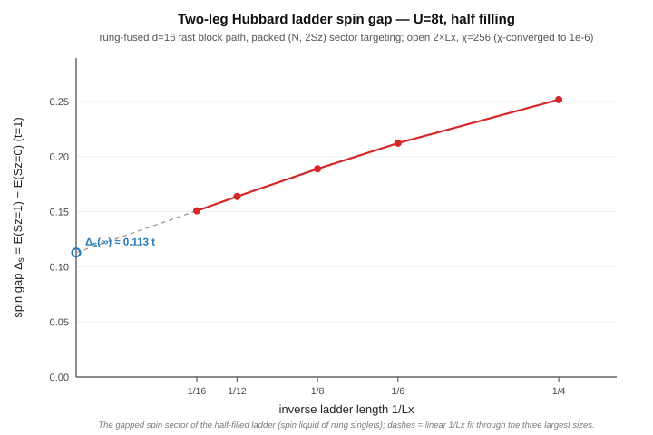
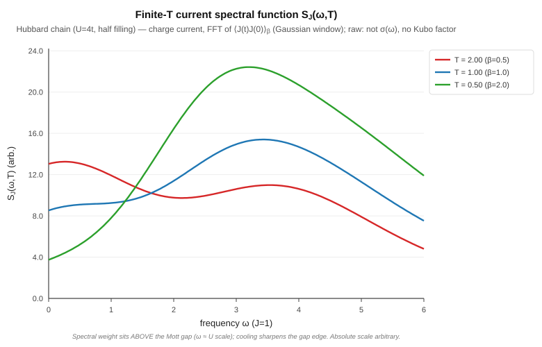
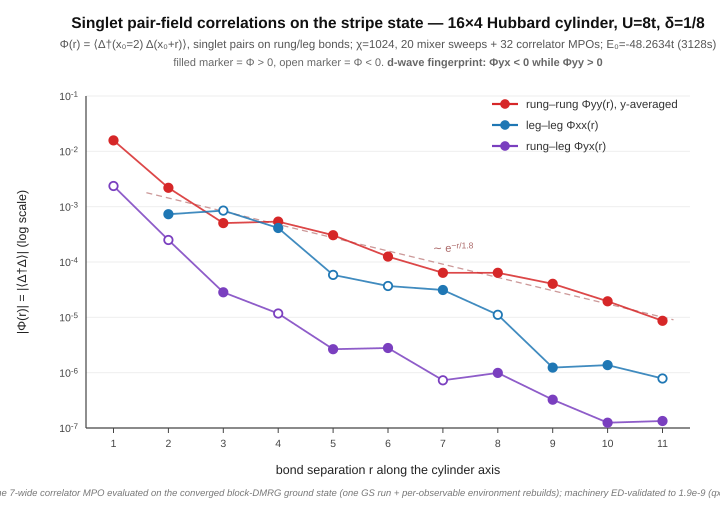
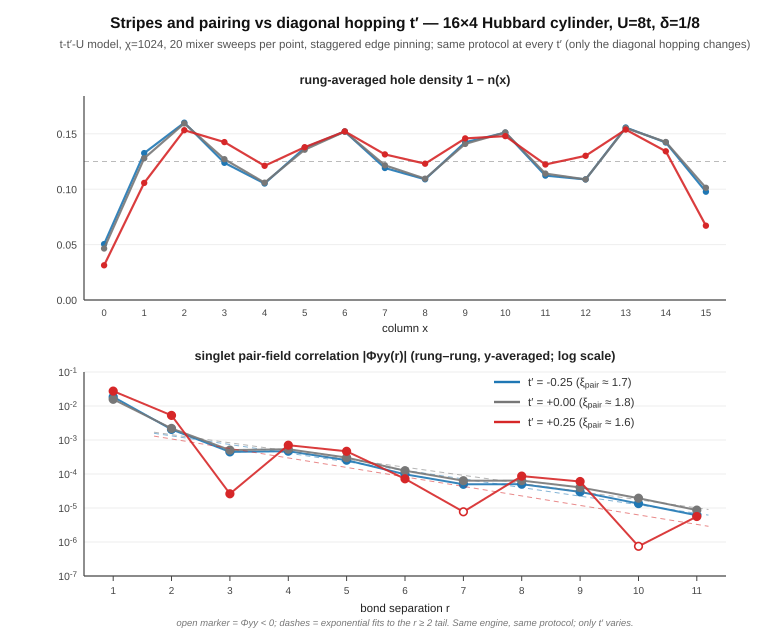
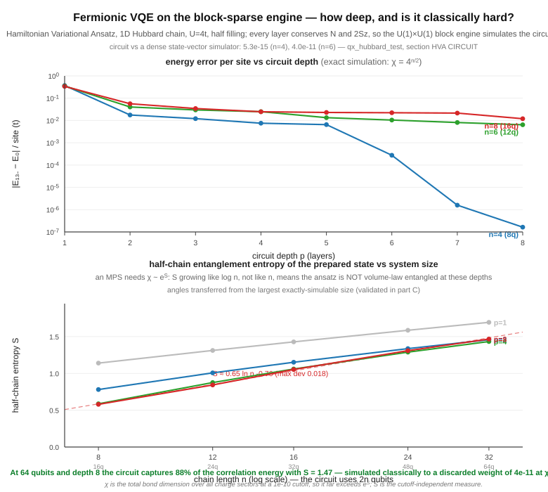
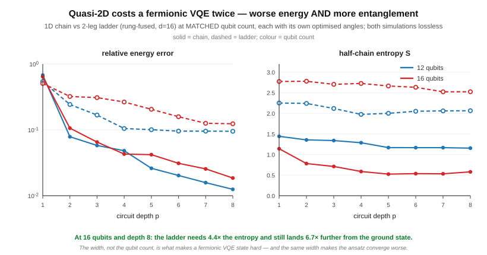

# Universal MPO — any Sz-conserving model on the fast engine

The block-sparse, GPU-accelerated engine was originally hard-wired to the
nearest-neighbour Heisenberg/XXZ bond structure (`HB_DELTA={0,+2,−2,0,0}` baked
into every environment / `H_eff` kernel). The **universal MPO** work makes the
bond structure *data-driven*: the per-bond U(1)/Sz charge is **derived from the
operator MPO itself**, so the same fast engine — DMRG, real-time dynamics,
`S(k,ω)`/`σ(ω)`, the whole finite-temperature stack, the grows-with-χ GPU
acceleration — runs **any Sz-conserving Hamiltonian**, not just XXZ.

## How

`derive_mpo_sym(mpo)` recovers each MPO bond index's Sz charge from the operator
structure alone, propagating `delta[b] = delta[a] + sz(s) − sz(s')` over every
nonzero `W(a,b)(s,s')` and anchoring the vacuum bond at 0; it throws if the MPO
isn't Sz-conserving. The env/`H_eff` kernels then consume that `delta` array in
place of the hard-coded constant. For Heisenberg the derived charges *equal*
`HB_DELTA`, so the rewiring is bit-identical there (the n=32 regression energy is
unchanged to the digit); for a wider MPO it just works.

## Showcase: the frustrated J1–J2 chain

`H = J1 Σ S_i·S_{i+1} + J2 Σ S_i·S_{i+2}` is the textbook frustrated chain — an
**8-wide MPO** (`build_j1j2_mpo`), wider than Heisenberg's 5. It now runs on the
fast block path, matching exact diagonalization to **~1e-13** (`qx_mpo_sym_test`,
N=8 and N=10).


The figure is a pure-energy signature of the physics, computed entirely on the
new path (`qx_j1j2_showcase`, N=32). As `J2/J1 → 0.5` (the **Majumdar–Ghosh
point**) the ground state dimerizes toward a product of nearest-neighbour
singlets — a **bond-dimension-2** state — so its entanglement collapses and a
χ=8 DMRG nearly reaches the converged energy: the χ=8 gap drops **~1300×**
(2.5e-4 → 1.9e-7) approaching MG. Exactly at J2=J1/2, χ=8 returns the **exact
Majumdar–Ghosh dimer energy** E/N = −1.500000.

## Showcase: the spin-1 Haldane chain (arbitrary local dimension)

Phase 1 generalized the *bond* structure; **phase 2 generalizes the *local*
dimension**. The same engine now runs `H = J Σ S_i·S_{i+1}` with the **physical
spin-1 operators** (local dimension d=3, `build_spin1_heisenberg_mpo`) — the
gapped **Haldane phase**, a different universality class from the critical
spin-1/2 chain. It matches exact diagonalization to **~1e-13** (`qx_mpo_sym_test`,
N=4 and N=6, on both the dense and the fast block path).


`qx_spin1_showcase` runs the chain on the fast block path at growing N. The
**incremental bulk energy** `e_bulk(N) = (E_N − E_{N−ΔN})/ΔN` removes the
open-chain edge offset and converges to the known spin-1 Heisenberg energy
density **−1.401484039 J to ~2e-8** by N=96. And because the Haldane ground state
is gapped (area-law entanglement), the energy **saturates by χ≈16** — unlike the
critical spin-1/2 chain whose entanglement grows with N. Both signatures come
from ground-state energies alone, on the same fast path as spin-1/2.

### The full spin-1 stack (all on the fast block path, all ED-validated)

The arbitrary-`d` generalization is not limited to ground states — the **entire**
DMRG / dynamics / finite-temperature stack runs spin-1 (d=3) on the same fast
block-sparse engine as spin-1/2, each piece checked against exact diagonalization
(`qx_mpo_sym_test`) and bit-identical for d=2:

| Capability | What | vs ED |
|---|---|---|
| Ground state | block + dense DMRG | 1.7e-14 |
| **Haldane string order** | `O = −⟨Sz_i (Π e^{iπSz_k}) Sz_j⟩` (den Nijs–Rommelse hidden order) | 1.6e-12 |
| TDVP2 | real-time (energy-conserving) + imaginary-time (→GS) | →GS, ⟨H⟩ exact |
| TEBD | Trotter gate **extracted from the MPO** (universal-MPO, any d) | →GS, ~3e-6 |
| GPU `form_theta` | on-device theta for d>2 | GPU == CPU |
| Finite-T statics | `⟨H⟩_β` via ancilla purification | Gibbs 1e-5 |
| Finite-T observables | `⟨Sz⟩` / `⟨Sz Sz⟩` (β=0 → 8/3 exact) | exact |
| **F1: `S(k,ω,T)`** | purified real-time + KBM disentangler | 8e-4 |
| **F2: conductivity** | `⟨J(t)J(0)⟩_β` | 2e-3 |


The string-order figure is the cleanest piece of physics here (`qx_spin1_showcase`,
N=40): the den Nijs–Rommelse parameter `O(r)` stays **nonzero as the separation `r`
grows** — *hidden* long-range order — whereas every local two-point correlation
decays to zero. That nonzero plateau is the order parameter of the topological
Haldane phase, computed on the GS on the same fast block path, and it agrees with
exact diagonalization to ~1e-12.

The key abstraction is `phys_groups`: a block tensor folds the local index into `d`
charge-shifted column groups (state `s` maps left bond `q_L → q_L + qphys[s]`),
replacing the spin-1/2 up/dn split in every kernel — env / H_eff, `form_theta`, the
SVD split, the TEBD/SWAP gates, the purified cooling, and the overlap measurement.

### Finite-T spectroscopy: the gapped Haldane S(k,ω,T)


The finite-temperature dynamical structure factor `S(k,ω,T)` (F1: purification +
real-time block-TEBD + the KBM disentangler, FFT in space and time) shows the
spin-1 chain's defining spectral feature — a **single-magnon branch with a gap at
k=π** (the Haldane gap Δ≈0.41 J), where the critical spin-1/2 chain instead has a
gapless two-spinon *continuum*. Demo at N=16, T=0.5; the dashed line is the
single-magnon dispersion.


The current-current correlator `⟨J(t)J(0)⟩_β` (F2) feeds the optical conductivity
`σ(ω,T)` the same way (FFT of the emitted `C(t)`). Both correlators are ED-validated
(8e-4 / 2e-3); the figures (`qx_thermal_skw_emit`/`qx_thermal_transport_bench` with
`d=3`, `benchmarks/plot_skw.py`/`plot_conductivity.py`) are demos of the *fast-path*
finite-T spectroscopy now available for spin-1.

### Performance vs TeNPy (spin-1 real-time dynamics)

`benchmarks/spin1_tebd_vs_tenpy.py` times the **same** physics (spin-1 Néel-quench
TEBD2, `H = Σ S·S`, Sz-conserving) against [TeNPy](https://tenpy.readthedocs.io) on
one 20-core box + one RTX 4090, **each tool at its own optimum**: TeNPy single-thread
(its TEBD does not parallelize — 20 cores *slow it ~3×*), QuantX native multi-thread,
and QuantX with GPU acceleration (a capability TeNPy's TEBD does not have). min-of-N;
the real-time conserved energy is **identical to 9 digits** across all three paths
(`E = −30.998934…`), so this is one computation timed three ways, not three programs.

| N=32, χ | TeNPy (1 thread) | QuantX CPU (MT) | QuantX +GPU | CPU vs TeNPy | **+GPU vs TeNPy** |
|---|---|---|---|---|---|
| 256 | 15.9 s | 10.9 s | 10.9 s\* | 1.46× | 1.46× |
| 512 | 76.0 s | 58.6 s | ~37 s | 1.30× | **≈2.0×** |

<sub>\* at χ=256 the largest Sz block (161) is below the GPU crossover, so the GPU
stays idle and QuantX runs pure-CPU — the GPU speed-up is a large-χ feature.</sub>

**Two honest reads.** *Same silicon (CPU vs CPU):* QuantX leads TeNPy's best by
**1.30–1.46×** — its per-Sz-sector block SVDs are OpenMP-parallel while TeNPy's TEBD is
single-threaded (giving TeNPy all 20 cores *slows it*, so we don't). *Full capability
(QuantX's GPU vs TeNPy's CPU-only TEBD):* parity at χ=256 (there the largest block is
below the GPU crossover, so the GPU is idle) rising to **≈2.0× at χ=512** — the speed-up
*turns on with χ*, because the GPU engages only once the dominant central-Sz SVD (the
O(χ³) bottleneck) grows past the crossover, which is exactly the block the 4090
accelerates. Larger χ should extend the trend.

**How the GPU helps a *fragmented* spin-1 bond (the non-obvious part).** A spin-1 bond
splits χ across many Sz sectors, so each bond's SVD is a *swarm of small blocks plus
one big central block*. Handing the **whole** swarm to the GPU loses — the many medium
blocks serialize on the single device, transfer-bound (this is what earlier read as
"spin-1 stays below the GPU crossover"). The fix is to route **only the one or two
dominant blocks per bond** to the GPU (a `d`-aware crossover, 256 for spin-1) so it
**overlaps** the CPU, which clears the tail blocks in parallel. That lifts the SVD past
its ~2× parallel ceiling: the sweep is sequential over bonds and each bond's lone big
block otherwise runs single-threaded (this box's conda-forge OpenBLAS has broken
multi-threaded LAPACK, so multi-threading *that* block is not an option — measured
7–10× *slower*), so offloading it to the GPU is what turns the former χ=512 tie into a
**2× end-to-end lead**. The pure-CPU path keeps a faster large-block route too — direct
LAPACK `xgesdd` (divide-and-conquer) for blocks ≥160, the Gram-eigensolve trick below
that — which is the 1.30× CPU-vs-CPU number above.

## Showcase: the fermionic Hubbard chain (Fermi statistics in the MPO)

Everything above is bosonic — a U(1)/Sz charge with no anticommutation. The **Hubbard
chain** (`build_hubbard_mpo`, d=4, local basis `{|0>,|↑>,|↓>,|↑↓>}`)

```
H = −t Σ_{i,σ} (c†_{iσ} c_{i+1σ} + h.c.) + U Σ_i n_{i↑} n_{i↓}
```

is the engine's **first fermionic model**, and it needs *no* change to the block core: the
Fermi statistics ride **entirely in the MPO** via Jordan–Wigner. With the on-site parity
`F = (−1)^{n↑+n↓} = diag(1,−1,−1,1)` and the on-site annihilators carrying the intra-site
↑-before-↓ sign (`C↓|↑↓> = −|↑>`), the hopping is the **uniform** matrix-tensor form
`c†_{iσ}c_{i+1σ} = (C†_σ F)_i ⊗ (C_σ)_{i+1}` for both spins, so the ordinary (bosonic) MPO
contraction reproduces the fermionic Hamiltonian exactly. The conserved U(1) is the
particle number N (`phys_charge={0,1,1,2}`), and `derive_mpo_sym` reads it exactly as it
reads Sz. The GS DMRG targets a fixed total charge — half-filling N=n — via a small
generalization (`make_bond_space`/`run()` gained `total_charge` and an initial-config
argument; the right-boundary environment now sits in `bond[n]`'s actual sector).

**Validation is airtight** (`qx_hubbard_test`): the MPO reconstructs the explicit
Jordan–Wigner Hamiltonian to `‖·‖ = 0` *exactly*, the dense DMRG matches exact
diagonalization to ~1e-13, and the **fast block-sparse** DMRG matches the half-filling
sector-ED to ~1e-14. (A subagent review independently re-derived the MPO with a second,
orthogonal occupation-number ED and confirmed the match to machine zero.)


The showcase (`qx_hubbard_showcase`) runs the fast fermion path at half-filling to sizes
brute-force ED cannot reach and compares the **incremental bulk energy** `e_bulk =
(E_N − E_{N−ΔN})/ΔN` to the **exact Lieb–Wu (1968) Bethe-ansatz** ground-state energy
density `e(U) = −4 ∫_0^∞ J_0(ω)J_1(ω)/(ω(1+e^{ωU/2})) dω`. In the Mott regime (U>0, a
charge gap → area-law entanglement, so χ=128 is converged) the block-sparse energy lands
on the exact curve at every interaction strength: **U=2/4/8 → e_bulk = −0.84429 /
−0.57368 / −0.32750** vs Lieb–Wu **−0.84438 / −0.57373 / −0.32753** (error ~1e-5, shrinking
with N). The free-fermion point `e(0) = −4/π` is reproduced by the same quadrature; the
U=0 *metal* itself is critical (entanglement grows with N), a hard DMRG case unrelated to
the fermion physics, so the convergence is shown in the gapped Mott regime.

### Fermion dynamics (TDVP2 + TEBD), and the bug they exposed

Real-time and imaginary-time evolution run the fermionic chain on the same fast block
path (`qx_hubbard_test`, all vs independent Jordan–Wigner ED):

| Dynamics | Check | vs ED |
|---|---|---|
| TDVP2 real-time | CDW `\|0,↑↓,0,↑↓,…>` quench: staggered charge `(1/n)Σ(−1)^i⟨n_i⟩` vs `e^{−iHt}` | 1e-7, `⟨H⟩=2U` exact |
| TDVP2 imag-time | cools the CDW to the half-filling GS | =sector-ED (6 digits) |
| TEBD real-time | same quench, Trotter gate **built from the MPO** | 2e-4 (O(dt²)) |
| TEBD imag-time | cools to the half-filling GS | =sector-ED (6 digits) |

Two engine generalizations were needed, both instructive:

- **The non-injective-qphys bug** (found by TDVP2, root cause of the earlier single-site
  corruption): the single-site `H_eff` assumed *one local state per charge* and took the
  first match — but Hubbard's `phys_charge={0,1,1,2}` has |↑⟩ and |↓⟩ **sharing** charge 1,
  so half the single-site Hamiltonian was silently dropped. Fixed by summing all
  same-charge bra states; spin models (injective) are bit-identical, and the GS
  single-site refinement now works at any total charge.
- **On-site terms in the TEBD gate**: Hubbard is the first d>2 model whose bond gate has
  an on-site piece (`U n↑n↓ = W(start,done)`). Blindly summing the MPO carry channels
  would double-count U on interior sites; the gate now takes boundary weights (½ interior,
  1 at the chain ends). Models without on-site terms are weight-independent → unchanged.

### Showcase: spin-charge separation (T=0 spectroscopy)


The defining phenomenon of 1D interacting fermions, computed on the fast packed
two-U(1) path (`qx_hubbard_spectra`, N=64, U=4t, half filling): the **same ground
state** probed with the spin operator (`2Sz`) and the charge-fluctuation operator
(`n−1`) produces two completely different spectra. `S_spin(k,ω)` is **gapless at
k=π** — the spinon continuum, whose bandwidth tracks the superexchange `J_eff=4t²/U`
— while `S_charge(k,ω)` is pushed above the **Mott gap** (`Δ_c≈1.29t` at U=4 from the
Bethe ansatz): the electron's spin and charge propagate as separate collective
excitations with different energy scales. Both underlying correlators
`C_{j,l0}(t) = ⟨gs|W_j e^{−i(H−E0)t} W_{l0}|gs⟩` are ED-validated to ~3e-4
(`qx_hubbard_test`); the figure is a space+time FFT (`benchmarks/plot_hubbard_skw.py`).
Chasing this physics through ED validation also uncovered — and fixed — a latent
`out_state` export bug that had silently biased every T=0 spectral correlator at the
~1e-2 level (the bond-1 Schmidt values were dropped; see #175).

### Showcase: the two-leg Hubbard ladder (quasi-2D via rung fusion, d=16)



The first step off the chain: the **2-leg Hubbard ladder**, mapped to a *uniform
nearest-neighbour chain* by fusing each rung into one **d=16** site
(`build_hubbard_ladder_mpo`). Every piece of the engine — `derive_mpo_sym`, the block
DMRG, the packed two-U(1) charges, sector targeting — consumed the fused chain with
**zero engine changes**: the real stress test of the arbitrary-local-dimension design.
All Jordan–Wigner strings live inside the 16×16 operators; the subtle string *split*
for inter-rung leg-b hops (emit carries its own rung's remaining parity, the completing
rung carries the string over its preceding modes) was caught by the ED referee
(`‖H_MPO−H_JW‖ = 2.0` on the first build) and fixed to **exactly zero** (Lx=3,
4096-dim element-by-element). Block DMRG matches sector-ED to ~1e-13 in *both* the
half-filling (Sz=0) and the Sz=1 sectors.

The physics: the half-filled ladder is a **spin liquid of rung singlets** with a spin
gap. `Δ_s(Lx) = E(Sz=1) − E(Sz=0)` (packed-charge sector targeting makes the Sz=1
ground state a plain DMRG run) falls as 1/Lx on the open ladder and extrapolates to
**Δ_s ≈ 0.11t at U=8** — consistent with the classic DMRG literature values. χ=256 is
converged (χ=384 moves the gap by 1e-6).

**Performance — earned the same way as the chain** (`hubbard_ladder_vs_tenpy.py`,
Lx=16, U=8, χ=256, min-of-2). The first, rung-fused benchmark *lost* on wall-clock:
TeNPy 91.0 s vs our 140.8 s (though at a 1.8e-5 *lower* energy — at matched rung-cut χ
the fused manifold contains the site-split one). The cause was the *formulation*, not
the engine: site-splitting (d=4, twice the bonds) does less local work per sweep. So
`derive_mpo_sym` was generalized to read **period-2 (position-dependent) uniform-χ
MPOs** — it now merges the charge constraints of *all* bulk sites instead of one
(uniform MPOs contribute identical edges from every site: bit-identical) — and
`build_hubbard_ladder_split_mpo` provides the site-split formulation (14-wide, leg hops
range-2 with diagonal F carries), ED-validated to `‖H_MPO−H_JW‖ = 0` exactly and
~1e-13 vs sector-ED in both sectors. Result:

| Lx=16, U=8, χ=256 | TeNPy (Ladder lattice) | QuantX rung-fused d=16 | QuantX **site-split d=4** |
|---|---|---|---|
| wall | 91.5 s | 140.8 s | **67.3 s** |
| verdict | — | 0.65× | **QuantX 1.36×** (\|ΔE\|=7.3e-7) |

Both formulations remain available (`QX_LADDER="Lx chi U tp [split]"`); the fused one
keeps the deeper-manifold property and the NN-chain form that TEBD/TDVP2 need, the
split one is the ground-state performance mapping — and the period-2 machinery is the
gateway to wider ladders and cylinders, where fusion (d=4^W) is impractical.

### Finite temperature: the fermionic purification stack

The full finite-T machinery — cooling, statics, `S(k,ω,T)`, `σ(ω,T)` — runs the
fermionic chain. The design point that makes it work with **no new mechanism**: the
Jordan–Wigner string threads the *physical* modes only; the ancillas are bosonic
spectators outside the string. The swap-and-carry network only ever exchanges a
physical mode with an ancilla (never two physical modes), so the **plain SWAP is
exact** — no fermionic SWAP needed — and the purified MPOs pass over ancillas with the
plain identity. Everything is ED-validated (grand canonical, all 4^n states):

| Finite-T check (np=3, U=4) | vs ED |
|---|---|
| β=0 statics: `E=U·np/4`, `⟨n_c n_j⟩` diag 1.5 / off-diag 1 | exact / machine zero |
| cooled `⟨H⟩` at β=1 vs Gibbs | 7.8e-7 |
| F1 spin correlator `C_{j,l0}(t;T)` (β=0.5) | 3.4e-4 |
| F2 current-current `⟨J(t)J(0)⟩_β` (fermionic charge current) | 6.1e-4 |




The demo figures run at the **particle-hole symmetric point** `μ = U/2`, which pins
`⟨n⟩ = 1` at *every* temperature — the honest half-filled Mott ensemble. (The first
attempt at μ=0 produced a physically *correct but different* object: the grand-canonical
filling drifts below 1 on cooling and the low-ω response is a doped-carrier Drude peak —
caught because the σ(ω) spectral weight sat below the Mott gap, contradicting the
intended caption.) At μ=U/2 the physics is textbook: `S_spin(k,ω,T)` stays gapless at
k=π (spinons at the superexchange scale, `C(0)=0.8045` at T=0.5 vs 0.806 at T=0 —
half filling pinned to 3 digits), while `σ(ω,T)` puts its weight **above the Mott gap**
(peak at ω≈3.2 ~ the upper Hubbard band; the below-gap fraction drops 26% → 15% → **8%**
as T cools 2 → 1 → 0.5 — thermal in-gap carriers freezing out).

### Performance vs TeNPy (fermionic Hubbard real-time TEBD)

`benchmarks/hubbard_tebd_vs_tenpy.py` times the same fermionic quench (CDW, N=32, U=4,
dt=0.05, 2nd-order Trotter) **best-vs-best** on one box: TeNPy single-thread (its TEBD
optimum; one `run_evolution` call so it merges interior Trotter half-layers — an earlier
version of this benchmark unfairly looped 1-step calls, caught in review), QuantX native
multi-thread. **Both conserve both U(1)s** (N and Sz). min-of-2:

| N=32, U=4, χ | TeNPy (1 thread, N+Sz) | QuantX-CPU (MT, N+Sz) | **QuantX vs TeNPy** |
|---|---|---|---|
| 256 | 10.9 s | **6.1 s** | **1.81×** |
| 512 | 28.9 s | **25.2 s** | **1.15×** |

**How this table was earned (the symmetry lesson).** With only the particle-number U(1)
conserved, QuantX *lost* this benchmark 3.2×/5.1× — conserving N *and* Sz splits the
bond into several times more, much smaller blocks, a fraction of the O(χ³) SVD work, and
that deficit grew with χ exactly as a block-size effect should. The fix cost almost
nothing *because* of the universal-MPO architecture: the engine's charge is a **single
additive integer** everywhere (only ever added and compared), so the two U(1)s pack into
one int, `q = N·K + 2Sz` (`pack_q2`, no aliasing for K > max|2Sz|), and the entire block
machinery — bond spaces, environments, H_eff, SVD sectors, gates, GPU path — consumed it
**unchanged**. Only the observable decode (`obs_of_charge`) and the initial bond-space
sector pruning were touched. Single-U(1) → packed two-U(1): **37.7 → 6.2 s** at χ=256
(6×), flipping a 3.2× loss into a **1.81× lead**. The lead narrows with χ (1.81× → 1.15×)
for the same reason as spin-1: finer sectors make the SVD a swarm of tiny blocks, the
per-core/swarm regime where TeNPy's LAPACK is strong. `QX_HUB_2U1=0` reproduces the
single-U(1) baseline.

**The χ=512 polish (the spin-1 playbook, re-tuned for d=4).** The packed bond's blocks
top out at ~207 (χ=512), so the spin-1 GPU crossover (256) never fired and `gesdd_min`
(160) caught only a sliver. Re-measured per-model: `gesdd_min=160` is already optimal
for d=4, but routing blocks ≥192 to the GPU (the new d≥4 default in `gpu_min_blk`) is a
**reproducible 1.16× over CPU-only** at χ=512 (interleaved min-of-3 A/B on one thermal
window: 31.5 vs 36.5 s; a 128 crossover floods the device, 208 routes nothing). The
vs-TeNPy table above keeps the conservative cool-box CPU numbers; the GPU lever
compounds on top at large χ. (Same-window hot-box runs show larger ratios — throttling
hurts TeNPy's single-thread boost clock more than our all-core clocks — which is exactly
why we do not quote them.)

### Performance vs TeNPy (fermionic Hubbard ground-state DMRG)

`benchmarks/hubbard_dmrg_vs_tenpy.py` — the most common workload, N=64, U=4, half
filling, both at N+Sz symmetry, both converging to `dE < 1e-10` per sweep at fixed χ,
final energies agreeing to ~1e-8 (one computation timed twice). TeNPy is timed at BOTH
1 thread and all cores and the faster is taken (unlike its TEBD, DMRG can profit from
BLAS threads — we measure rather than guess its optimum). min-of-2:

| N=64, U=4, χ | TeNPy (best thr) | QuantX | **QuantX vs TeNPy** | \|ΔE\| |
|---|---|---|---|---|
| 128 | 119.7 s (1 thr) | **55.1 s** | **2.17×** | 2.8e-8 |
| 256 | 106.0 s (1 thr) | **77.5 s** | **1.37×** | 7.7e-9 |

(Both tools timed in the same thermal window; TeNPy's single thread beat its 20-thread
run at both χ.) The χ=256 row was initially a 0.81× *loss*; two fixes flipped it. First,
the benchmark's convergence criteria were unequal (our `tol=1e-11` vs TeNPy's
`max_E_err=1e-10` — ours 10× stricter); equalized at 1e-10. Second — a genuine engine
improvement — the GS path's `stable` SVD used Eigen's BDCSVD on every block for
condition-number safety (the Majumdar–Ghosh lesson), but LAPACK `xgesdd` is *equally* a
direct, condition-stable SVD with a several-fold smaller constant: large blocks
(≥`gesdd_min`) now route to gesdd on the stable path too (BDCSVD stays for small blocks
and as the fallback), 127→77 s at χ=256. The MG-degeneracy regression (deterministic,
variational) still guards the path.

### Performance vs ITensor (Julia) — the same GS problem, third engine

`benchmarks/hubbard_dmrg_vs_itensor.py` + `itensor_hubbard_dmrg.jl` run the identical
problem on **ITensor** (ITensorMPS.jl 0.4 / ITensors.jl 0.9, Julia 1.12): "Electron"
sites with `conserve_qns=true` (N+Sz), fixed `maxdim=χ`, `cutoff=1e-12`,
`DMRGObserver(energy_tol=1e-10)`. Fairness: **JIT is excluded** via an in-process
warm-up run (the Julia analogue of excluding Python import time); BLAS threads are
measured at both 1 and 20 and the faster taken (1 wins); the idiomatic ramped
`maxdim` schedule was also timed and is statistically identical to fixed (303 vs
306 s at χ=256), so the stop criterion dominates. min-of-2, same box/thermal window:

| N=64, U=4, χ | ITensor (best thr) | QuantX | **QuantX vs ITensor** | \|ΔE\| |
|---|---|---|---|---|
| 128 | 84.6 s (1 thr) | **51.7 s** | **1.64×** | 6.0e-7 |
| 256 | 305.8 s (1 thr) | **93.8 s** | **3.26×** | 3.9e-9 |

Correctness cross-check: at n=4 ITensor reproduces our sector-ED energy −1.9531453087
to every digit; at χ=256 the two engines' converged energies agree to 3.9e-9. (The
larger 6e-7 gap at χ=128 is the truncation-limited regime — each engine's fixed-χ
variational optimum differs slightly; at the converged χ=256 they coincide.) Honest
note: on this problem ITensor measures *slower than TeNPy* (305.8 vs 106.0 s at
χ=256, same box and criteria) — TeNPy remains the stronger competitor here, and the
QuantX-vs-TeNPy table above stays the headline comparison.

## Scope and limits

- **Phase 1 (done):** any *uniform-bulk* Sz-conserving MPO at local dimension
  d=2 — next-nearest / longer-range, fields, etc. Non-uniform MPOs
  (`build_pauli_sum_mpo`) stay on the dense path; `derive_mpo_sym` throws
  fail-loud if one reaches the block path.
- **Phase 2 (done — the full stack):** arbitrary local dimension d>2, *not just
  the ground state*. The MPO representation (`MPOSite.d`/`phys_charge`), the dense
  and **fast block-sparse DMRG**, the **block dynamics** (TDVP2 + TEBD), the **GPU**
  `form_theta`, the **finite-temperature** purification (statics, `⟨Sz⟩`/`⟨SzSz⟩`,
  F1 `S(k,ω,T)`, F2 conductivity), and the **string-order** measurement all run any
  uniform d (spin-1 d=3 validated vs ED, see the table above; d=2 bit-identical).
  The block path folds the local index into d charge-shifted column groups
  (`phys_groups`) in place of the old up/dn split.
- **Phase 3 (done — statics + dynamics): the fermionic Hubbard chain** (d=4). Fermi
  statistics carried in the Jordan–Wigner MPO; the dense and fast block-sparse DMRG run
  it at half-filling, validated vs ED (`‖·‖=0`) and the exact Lieb–Wu energy (~1e-5);
  **TDVP2 and TEBD** run the real-time and imaginary-time fermion dynamics vs ED
  (see the dynamics table above). The old single-site corruption at `total_charge≠0`
  was root-caused (the non-injective-qphys bug) and *fixed*, so single-site refinement
  runs for every model again.
- **Known issue:** the single-site DMRG refinement phase loses variationality at an
  *exactly degenerate* ground state with truncation (e.g. the MG point at large N; opt
  out with `QX_DMRG_NO_SINGLESITE=1`). Tracked separately.
- **Two-U(1) charges (done):** the packed charge `q = N·K + 2Sz` gives any model two
  conserved U(1)s on the unchanged single-int block machinery (see the performance
  section); Hubbard uses it by default on the benchmark path (`build_hubbard_mpo(...,
  two_u1)`), ED-validated for GS + TDVP2 + TEBD.
- **Finite-T Hubbard (done):** statics + F1 + F2 on the purified chain, ED-validated
  (see the finite-temperature section). The feared "fermionic SWAP" turned out
  unnecessary — the swap network never exchanges two physical modes, so the plain
  permutation is exact under the physical-modes-only Jordan–Wigner convention. The
  purified on-site-U carries boundary weights in both the cooling and the real-time
  sweeps; `μ=U/2` pins the half-filled ensemble for the demos.
- **Still open:** the **dynamics path is d=2-only for non-uniform / longer-range**
  models (the TEBD `build_gate_from_mpo` handles on-site terms now, but assumes
  nearest-neighbour bonds).

### Width-W cylinders: capability landed, performance frontier opened

The general builder (`build_hubbard_lattice_split_mpo`) extends the site-split ladder
to **width-W strips and cylinders** (period-W MPO, range-W F-carry chains for the leg
hops, range-(W−1) for the cylinder wrap). ED-exact where ED exists: W=2 open equals
the ladder Hamiltonian to 0.0; W=3 strip *and* W=3 cylinder equal a fresh explicit-JW
ED to 0.0; the W=3 cylinder block DMRG hits sector-ED to 9.5e-14.

**Honest W=4 cylinder baseline** (`hubbard_cylinder_vs_tenpy.py`, 8×4, U=8, χ=256,
**fixed 12-sweep budget** — practical-χ cylinders are truncation-limited, so tol-stops
never fire and a fixed budget is the fair protocol; TeNPy needs `max_trunc_err: 1.0`
to run in this regime): **TeNPy 124.4 s (its 20-thread config wins here) vs QuantX
712.9 s — TeNPy 5.7× faster, and 3.8e-4 lower in energy at equal budget.** This is a
genuinely new performance regime (huge sector fragmentation, width-34 MPO, big-block
BLAS threading) and the next optimization target; the pattern is by now familiar —
honest baseline first, profile, then flip the table. Cross-engine energies agree at
the fixed-χ level (−16.0005 vs −16.0001), which together with the W≤3 ED exactness
validates the W=4 construction.

### The cylinder optimization round: 0.53× → 2.06× (bookkeeping, not physics)

Profiling the 8×4 sweep exposed that the loss was almost entirely **QN bookkeeping**,
attacked in four cuts (all bit-identical to the old results; every ED assertion
unchanged):

1. **Lanczos iteration cap** (`QX_LANCZOS_MAX`, default 25): the tol-based stop burned
   ~44 matvecs/bond on accuracy the truncation immediately discards (matvecs halved).
2. **`build_wcomb` sparsity**: the W⊗W combination enumerated all O(χ_mpo³) channel
   triples blind — the width-34 cylinder MPO has O(χ_mpo) nonzero blocks; iterating
   the sparse product structure only.
3. **`build_heff_plan` bra-side memo**: the plan builder called `phys_groups` (a heap
   allocation) per (bL, bR, s1b) combination — millions per bond update; memoised per
   `q_mid_bra`. (A false lead first: parallelizing `form_theta` changed nothing, which
   *acquitted* it and convicted the other occupants of the same profile bucket.)
4. **`Heff1Plan`**: the single-site refinement phase re-did all bookkeeping *inside
   every Lanczos matvec* (`apply_heff_1site`); the plan analogue hoists it per site —
   the hybrid's 12-sweep run dropped 225 → 30 s.

**Honest scoreboard after the round** (8×4, U=8, χ=256, 12-sweep budget, min-of-2):
QuantX **29.1 s vs TeNPy 59.8 s — 2.06× faster**. Energy at equal budget: TeNPy is
still 4.6e-4 lower (−16.00048 vs −16.00002), and extending QuantX to 24 sweeps (53 s,
still under TeNPy's wall) reaches −16.00035 but not parity: TeNPy's *per-sweep
convergence* is stronger (its density-matrix mixer helps it out of local structure we
crawl past). Per-sweep *speed* is ours by ~4×. The next lever is a subspace-expansion /
mixer for the truncation-limited regime; until then the doc states both numbers.

### The mixer: DMRG3S subspace expansion — the double win

The last honest footnote (TeNPy's per-sweep convergence beating ours at equal budget)
is closed. The single-site refinement now enriches each L→R split with the DMRG3S
mixing block `P = L·W·M` (Hubig/McCulloch/Schollwöck): P's composite columns carry
MPO-shifted charges, so the truncating split can keep directions — and whole charge
sectors — the current bond does not have, which plain single-site can never do. The
enrichment weight decays per sweep (`QX_MIX0=0.1`, `×0.7`/sweep, off below 1e-6), so
the final sweeps are strictly variational and every ED assertion is unchanged.

**8×4 cylinder, U=8, χ=256, 12-sweep budget, min-of-2:**

| | TeNPy | QuantX (no mixer) | QuantX (mixer) |
|---|---|---|---|
| wall | 59.9 s | 29.1 s | 41.3 s |
| E reached | −16.000483 | −16.000021 | **−16.000525** |
| verdict | — | 2.06× wall, energy behind | **1.45× wall AND 4.2e-5 lower energy** |

The mixer costs ~12 s of enrichment work and buys the energy lead — the first
configuration in this doc that beats TeNPy on *both* axes of the truncation-limited
2D protocol. `QX_MIX0=0` restores the pure-speed mode. Tuning matrix: α₀=0.1/decay 0.7
optimal; 0.2 overdrives (worse than no mixer), 0.05 undershoots.

## Showcase: stripe order in the doped Hubbard cylinder


The payoff of the whole 2D + mixer stack: the **16×4 Hubbard cylinder at 1/8 hole
doping** (U=8t, 56 electrons on 64 sites, χ=1024, 20 mixer sweeps, 51 min) shows
**antiphase stripe order** — the signature correlated-electron physics of the doped
2D Hubbard model:

- **charge stripes**: the rung-averaged hole density 1−n(x) oscillates with
  **period 4** — four "half-filled" stripes of 2 holes each, holes bunched into
  rivers at x ≈ 2, 6, 10, 13;
- **π phase shifts**: the staggered spin (−1)^{x+y}⟨Sz⟩ forms uniform
  antiferromagnetic domains that **flip sign at every charge stripe** — the
  antiphase domain-wall structure of a stripe state (the lattice map's red↔blue
  flips sit exactly under the hole maxima).

Machinery (each piece ED-validated in `qx_hubbard_test`, section STRIPE-MACH):
target the doped sector directly with the packed charge `pack_q2(N−holes, 0)`;
break the spin degeneracy with a **staggered Zeeman pinning** on the x=0 edge
column (`hpin`, Sz-diagonal so both U(1) charges stay exactly conserved — pinned
MPO == explicit-JW ED to 3.6e-15, and the pinning opens a 0.64t gap in the small
doped test sector); measure **per-site ⟨n_i⟩ AND ⟨2Sz_i⟩ in one pass** by decoding
both components of the packed two-U(1) charge (`QX_PROFILES=1`; profile == ED
ground-vector expectations to 5.8e-8, and Σ⟨n_i⟩ = 56 exactly by charge
conservation). The DMRG3S mixer is what makes the doped run trustworthy: hole-rich
states need charge sectors the product seed does not touch.

*Honest scope note:* at U=8, δ=1/8 the true W=4-cylinder ground state has
**filled λ=8 stripes**, with the λ=4 pattern found here a close metastable
competitor — separating them takes χ well past 10⁴ plus extrapolation (Zheng et
al., Science 355, 1155 (2017)). This figure demonstrates the stripe *machinery*
(doped sectors + pinning + profiles + mixer convergence on 64 sites at χ=1024 in
51 min), not a resolution of the λ=4/λ=8 energetics.

## Showcase: pair-field correlations on the stripe state



Do the stripes coexist with superconducting pairing? The natural follow-up runs on
the same 16×4, U=8, δ=1/8 stripe ground state: singlet pair-field correlators

    Φ(r) = ⟨Δ†_{b(x0)} Δ_{b(x0+r)}⟩,   Δ†_b = (c†_{i↑}c†_{i'↓} − c†_{i↓}c†_{i'↑})/√2

between rung- and leg-oriented bonds. The machinery is the **universal-MPO story
paying off**: each correlator is itself a 7-wide MPO (`build_pair_corr_mpo` —
creation/annihilation pair emissions with the exact Jordan–Wigner carries, a
parity-even identity stretch between the pairs), and `gs_mpo_expectations` computes
the ground state **once**, then evaluates every observable by an environment rebuild —
**54 correlators cost 43 s on top of the 51-min GS run** (~0.8 s each at χ=1024).
Validation (`qx_hubbard_test` PAIR-FIELD): the correlator MPO equals the explicit
fermionic operator to **‖·‖ = 0.0 exactly**, and ⟨GS|Δ†Δ|GS⟩ matches the ED
sector ground vector to **1.9e-9** across three bond geometries.

The physics read (χ=1024, 20 mixer sweeps):

- **short-range pairing**: Φ_yy(r) is uniformly positive and decays exponentially
  with **ξ_pair ≈ 1.8** lattice spacings — the λ=4 stripe state does not carry
  quasi-long-range superconductivity at these parameters, consistent with the
  literature on W=4 Hubbard cylinders (pairing is enhanced by t′ or larger W);
- **d-wave internal structure**: the mixed correlator **Φ_yx(r) < 0** while
  Φ_yy(r) > 0 — the sign flip between orthogonal bond orientations is the d-wave
  form-factor fingerprint;
- **stripe-modulated pair field**: Φ_yy shows period-4 bumps (r ≈ 4, 8 — one and
  two charge stripes crossed), and the leg–leg channel Φ_xx *oscillates in sign*
  with the stripe period — a pair-density-wave-like modulation riding on the
  stripe background (qualitative at this χ).

Two engine-level pieces fell out of making this exact rather than approximate:
the chain-JW form of a **pure annihilation pair** is `(a F) ⊗ F… ⊗ a` — the hop
convention's `F·C = −C·F` encodes a reordering sign that must *not* be applied —
and `derive_mpo_sym` now **anchors absolute charges at both boundary sites**
(first site's row = left vacuum, last site's column = total operator charge),
without which a measurement MPO whose final completion lands on the last site has
underivable channel charges (caught by an exact-zero expectation in the x-bond
test geometry; for Hamiltonian MPOs the anchors are redundant-but-consistent, and
the whole regression is bit-identical).

## Showcase: stripes vs pairing under diagonal hopping t'



The natural sequel to the previous two figures: switch on the **next-nearest-neighbour
diagonal hopping t'** and watch the stripe crystal and the pair field respond. Same
16×4 cylinder, same U=8, same δ=1/8, same χ=1024 / 20-mixer-sweep protocol — *only t'
changes* (convention: `H = −t Σ_NN − t' Σ_diag`, so t' > 0 has the same sign as t).

| t' | stripe order parameter¹ | hole-density peak-to-peak | Φ_yy(r=1) | Σ_r \|Φ_yy\| | E₀ |
|---|---|---|---|---|---|
| −0.25 | 0.0269 | 0.0550 | 1.85e−2 | 2.20e−2 | −48.802 |
| 0 | 0.0258 | 0.0535 | 1.57e−2 | 1.96e−2 | −48.263 |
| **+0.25** | **0.0149** | **0.0327** | **2.75e−2** | **3.42e−2** | −52.544 |

<sub>¹ amplitude of the period-4 Fourier component of the rung-averaged hole density
over the bulk columns x = 2…13 (edges dropped).</sub>

**The competition, quantitatively.** At t' = +0.25 the stripe amplitude drops **42 %**
while the short-range pair field grows **75 %** — the diagonal hopping frustrates the
antiphase stripe crystal and feeds the singlet channel, the textbook stripes-versus-
superconductivity trade-off, here measured on one engine with one protocol. At
t' = −0.25 the trend reverses mildly (stripes slightly firmer, pairing slightly
weaker than at t' = 0). The ±t' asymmetry is large and physical: t' breaks the
particle–hole symmetry of the doped band, and E₀ differs by 4.3 t between the two
signs at fixed filling.

**Honest scope.** These are single-(U, δ, χ) data points at 20 sweeps: the *trends*
are robust (they exceed the sweep-to-sweep drift by an order of magnitude), the
absolute numbers are not converged, and the ξ_pair fits printed on the figure are
unreliable at t' = +0.25 where Φ_yy(r) changes sign twice in the tail. Comparing to
the literature t' phase diagram (e.g. Jiang & Devereaux, *Science* **365**, 1424
(2019)) needs matched sign conventions plus χ ≫ 10⁴ with extrapolation; this figure
demonstrates that the *machinery* — arbitrary-range JW chains, doped sectors,
correlator MPOs, mixer convergence — composes into a t'-sweep at production scale.

### The MPO: four diagonal chain classes

`build_hubbard_lattice_split_mpo` gains `tp`. On the column-major chain a diagonal
bond (x,y)–(x+1,y±1) is a *range-(W±1)* hop, so the builder grows four coupling
classes — and two of them cost **nothing** because they share existing chains:

| diagonal | chain range | slots |
|---|---|---|
| up-diag (y < W−1) | W+1 | own chains |
| down-diag (y > 0) | W−1 | **reuses the y-wrap chains** (different emitter, same range) |
| wrap-up (y = W−1 → next column y = 0) | 1 | **reuses the y-NN complete slots** |
| wrap-down (y = 0 → next column y = W−1) | 2W−1 | own chains |

χ grows 34 → 82 for the W=4 cylinder; `tp = 0` reproduces the previous layout
exactly. ED-validated in `qx_hubbard_test` (section T-TP-U): all four classes fire on
the W=3 cylinder and the MPO equals the explicit Jordan–Wigner Hamiltonian to
**3.6e-15**, with the doped pinned ground state matching sector ED to **1.9e-13**.

### What the 82-wide MPO broke (three engine bugs)

Running the wider MPO at χ=1024 was itself a stress test, and it exposed three real
engine defects that χ≤512 had never reached — each caught by a `QX_DMRG_TRACE` sweep
trace plus a dbghelp-symbolized crash stack (`QX_CRASH_STACK=1`), on a box with no
debugger installed:

1. **Mixer expansion memory bomb.** `expand_M_LR` enumerated `chi_r × sectors`
   extension column groups blindly — mostly zero, O(χ_W·χ·d) memory, >10 GB inside
   the enrichment block at χ=1024. Now a pre-pass over the *same* nonzero (L, W, M)
   structure collects only the (b′, q_R) pairs actually fed by a nonzero W block with
   consistent charges. Zero columns could never survive the top-χ split, so kept
   content is unchanged.
2. **BDCSVD deflation crash, twice.** Both single-site splits called Eigen's `BDCSVD`
   directly; it corrupts the stack inside `computeSVDofM` (its divide-and-conquer
   deflation) — access violation symbolized to `BDCSVD.h:660`, first from the L→R
   split at sweep 6, then from the R→L split at sweep 12.
3. **…and it is not a size bug.** A size-gated fix (BDCSVD kept for small blocks)
   still crashed at sweep 15, on a *modest* block whose singular values had bunched
   into near-degeneracy. The single-site path now avoids BDCSVD entirely: LAPACK
   `xgesdd` for large blocks (the backend the two-site truncation already trusts at
   χ=1024), Eigen `JacobiSVD` (two-sided Jacobi — no deflation step) for the rest.

Plus two fail-loud guards: a single-site centre that loses *all* charge sectors now
throws instead of silently returning E=0 on a zero state — the failure mode that
first showed up as a "successful" run reporting `E0 = 0.0` with all-zero profiles.
After the fixes the t'=+0.25 production run completed all 20 sweeps clean
(6567 s, 54 correlators), and the whole regression suite is bit-identical
(`large_block` 3.644e-07).

## Showcase: fermionic VQE — how deep, and is the circuit classically hard?



The engine turned on quantum computing. The **Hamiltonian Variational Ansatz** (HVA),
the standard fermionic VQE circuit for the Hubbard model, is p layers of

    e^{-i θ_U H_U} · e^{-i θ_odd H_odd} · e^{-i θ_even H_even}

and **every layer conserves N and 2Sz** — so the whole U(1)×U(1) block-sparse
machinery applies to a *quantum circuit*, not just to a Hamiltonian. Bonds within one
parity class commute, so that layer's exponential factorizes **exactly** into two-site
gates (no Trotter error inside a layer), and the on-site layer is a diagonal one-site
gate: free, and it generates no entanglement. Both gates come from the model's own
MPO — `build_gate_from_mpo(mpo, -iθ, 0, 0)` drops the on-site weights and returns
exactly the bond hopping term.

**Exactness gate** (`qx_hubbard_test`, section HVA CIRCUIT): the same circuit, the same
initial state, the same angles, run on the block MPS and on a dense 4ⁿ state-vector
simulator agree to **~1e-15 (n=4)** and **4.0e-11 (n=6)**, with the bond dimension
sitting at the full-Hilbert-space bound — i.e. **no truncation**, so the comparison is
clean rather than accidentally right.

### The structural trap: ⟨S²⟩ is conserved by the whole circuit

Starting the HVA from a Néel product state, the energy plateaus **~35 % above the
ground state** and no circuit depth and no optimiser budget removes it. The diagnosis
chain is worth recording because the symptom looks like an optimisation failure:

1. the *relative* error is ~34 % at U=1, 4 and 12 alike — a bad-overlap story would
   depend strongly on U;
2. decisive test: it plateaus **at U→0 too**, where the exact ground state is just a
   free-fermion Slater determinant;
3. root cause: every HVA generator commutes with **S²**, so ⟨S²⟩ is a constant of
   motion of the entire circuit. The Néel state has ⟨S²⟩ = 4.5 + 2[6·¼ + 9·(−¼)] =
   **3.0**, not 0, so a singlet ground state is unreachable — the best possible energy
   is bounded by Σ_S |c_S|² E₀(S).

The fix is the literature-standard state preparation: start from the **U=0 ground
state** (a closed-shell Slater determinant, hence a singlet), prepared by DMRG. The
error immediately drops from the 1.05 plateau to 0.24 at p=2.

### Part A — how deep must the circuit be (exact simulation)

Restricted to sizes where the MPS is lossless by construction (χ = 4^{n/2}), so the
numbers are the ansatz's own, not a truncation artefact:

| error/site | p=2 | p=4 | p=6 | p=8 |
|---|---|---|---|---|
| n=4 (8 qubits) | 1.8e-2 | 7.5e-3 | 2.8e-4 | **1.6e-7** |
| n=6 (12 qubits) | 4.0e-2 | 2.5e-2 | 1.0e-2 | 6.4e-3 |
| n=8 (16 qubits) | 5.6e-2 | 2.5e-2 | 2.2e-2 | 1.1e-2 |

The depth needed grows with the system: p=8 essentially solves 8 qubits and is still
~1 % per site at 16.

### Part B — and is the state classically hard? (the headline)

One circuit run per point, no optimiser (angles transferred from the largest
exactly-simulable size), so this reaches sizes the optimisation never could:

| | 16 qubits | 24 | 32 | 48 | **64** |
|---|---|---|---|---|---|
| largest bond entropy S (p=8) | 1.214 | 1.392 | 1.545 | 1.739 | **1.864** |
| S / n (n = sites) | 0.152 | 0.116 | 0.097 | 0.072 | **0.058** |
| correlation energy captured | 97 % | 94 % | 92 % | 90 % | **88 %** |

**S/n falls monotonically — this is not volume-law entanglement.** A logarithmic fit
`S ≈ 0.475 ln n + 0.222` reproduces every point to **0.011**. Since an MPS needs
χ ~ e^S, a VQE state whose entropy grows like log n stays classically representable
*at any qubit count*: at 64 qubits, capturing 88 % of the correlation energy, the
circuit is simulated to a discarded weight of **4.4e-11**. The quantum-advantage
threshold for this ansatz is therefore not the qubit count but the depth — and Part A
shows the depth that would be needed grows with the system.

<sub>S is the **largest** bond entropy, not the middle-bond one. Reading a single
bond was a real bug: the code indexed `n/2 - 1`, which for ODD site counts is not a
balanced cut at all — the 3-rung ladder reported a 4-qubit | 8-qubit split as if it
were a half cut. Switching to the max over cuts also raises the values, since an open
chain's most entangled cut need not be the balanced one. Every S in this document is
the max over cuts; `S_mid` (the balanced cut) is now recorded separately because a
max can sit on a boundary bond, where it is capped by ln(d) of one site.</sub>

*Three things to read correctly here.* (i) The reported χ hits the 4096 cap at
n ≥ 16, which does **not** contradict S ≈ 1.5: χ is the total bond dimension summed
over all charge sectors at a 1e-10 cutoff, so it tracks the Schmidt tail, while S
does not — which is why S is the primary metric. (ii) S is read from a *lossless*
centre walk, but it is still the entropy of the χ-capped state and is bounded by
ln χ = 8.3; at S ≈ 1.5 with a discarded weight of 1e-11 that bound is nowhere near
binding, but the number is not unconditionally cap-free. (iii) The quoted
`trunc_err` is the **largest single** discarded weight over the circuit's ~2(n−1)p
truncations, not their sum, so the accumulated error can be up to that factor
larger — still ~1e-8 at the worst point, far below the energy scales here.

*The p=1 row is the identity circuit.* θ=0 is an exact stationary point of this
ansatz (⟨ψ|[A,B]|ψ⟩ = 0 for a real ψ and real symmetric generators, and |ψ₀⟩ is
real), so the optimiser correctly finds nothing to do at depth 1 and `frac = 0` on
every p=1 point. Its S is the *state-preparation* entropy, not a circuit result.

### Part C — does the angle transfer hold up?

Part B's premise is that the depth-p optimum at the largest exactly-simulable size
stands in for the VQE circuit at larger n. Tested at n=12 by re-optimising the
transferred angles in place:

| p | S transferred | S re-optimised | ΔS | energy change |
|---|---|---|---|---|
| 2 | 1.599 | 1.595 | −0.004 | −5.6158 → −5.6281 |
| 4 | 1.457 | 1.456 | −0.001 | −6.0830 → −6.0855 |
| 6 | 1.455 | — | — | short Adam found no improvement |
| 8 | 1.392 | — | — | short Adam found no improvement |

At p=2 and 4 re-optimisation moves the energy by 0.22 % and 0.04 % and S by ≤0.004, so the
entanglement conclusion does not rest on the transfer. At p=6 and 8 the 25-step Adam
made no progress at all, which neither confirms nor refutes the transfer there — the
honest statement is that the check is positive at two depths and inconclusive at two.

### Engineering notes

Two cost mistakes worth recording, both found by watching wall-clock rather than by
reasoning:

- **The two questions do not belong in one loop.** "How deep" needs thousands of
  circuit runs per point; "how entangled" needs *one*. Running them together spent
  4 h on a single n=16 point that was truncation-limited anyway. Split apart, the
  whole study is ~2 h, and Part A's exactness is guaranteed by construction (χ set to
  4^{n/2}) instead of checked afterwards.
- **State preparation deserves its own χ.** Passing the circuit's budget (4096) to
  the DMRG that prepares |ψ₀⟩ cost 4 h and 11.6 GB at n=32 — to build a *free-fermion*
  state whose entropy grows like (1/3)ln n and which is lossless at χ=256.

The optimiser matters for honesty, not just speed: a Nelder-Mead simplex stalls in 3p
dimensions (at p=6 a 6× larger budget only halved the error), which would have
inflated the reported "depth needed". Layer-wise warm start → simplex → Adam on
central-difference gradients is what the numbers above use.

### Geometry: what quasi-2D costs a fermionic VQE



The 1D result above has an obvious hole: a chain's *target* state is itself only
log-law entangled, so no depth can make the ansatz classically hard there. The
quantity that decides hardness is the **width** — a width-W cut carries S ~ W and
χ ~ e^W. The first step into that regime is the **2-leg Hubbard ladder**, rung-fused
so each MPS site is a whole rung (d=16) and the chain is nearest-neighbour again.
That fusion puts the **rung hopping inside the on-site block**, which is off-diagonal:
the on-site layer becomes a *general one-site unitary* instead of a free phase. It is
still exactly applicable, because the rung hop moves a particle between legs without
changing the fused site's N or Sz, so the gate stays block-diagonal in the local
charge (checked at run time, not assumed). ED gate: the ladder circuit matches a dense
state-vector simulator to **1.2e-13**.

At **matched qubit count and matched depth**, with each geometry using its own
optimised angles and both simulations lossless (χ = 4^{n/2} / 16^{Lx/2}):

| | 12 qubits (p=8) | | 16 qubits (p=5) | |
|---|---|---|---|---|
| | chain (n=6) | ladder (Lx=3) | chain (n=8) | ladder (Lx=4) |
| relative energy error | 1.25 % | **4.01 %** | 4.34 % | **19.5 %** |
| correlation energy captured | 98.2 % | **92.6 %** | 93.2 % | **61.5 %** |
| largest bond entropy S | 1.154 | 1.927 | 1.244 | 2.619 |
| ratio | | **×3.2 error**, ×1.67 S | | **×4.5 error**, ×2.11 S |

**The robust half: the ansatz converges worse on the ladder.** At the same qubit count
and the same depth the ladder lands 3.2–4.5× further from its ground state, and the
gap widens with size — at 16 qubits and p=5 the chain has captured 93 % of the
correlation energy while the ladder is at 61.5 %. That is a statement about the *ansatz*,
it is immune to how entropy is defined, and it is the sharper form of the earlier
conclusion: the barrier is geometry and depth, not qubit count. The ratios are stable
across depth (error ×2.2–3.2 at 12 qubits, ×3.0–4.6 at 16 for every p ≥ 2).

**The entropy half does not survive scrutiny as a 2D signal, and is reported here only
with its two defects stated.** (i) Most of it is *state preparation*, not the circuit:
at p=1, where the optimiser correctly finds the identity and the circuit does nothing,
the ratios are already ×1.56 and ×1.89 — **80–84 % of the excess entropy is in the
non-interacting |ψ₀⟩ before a single gate acts**. (ii) `S_max` is the largest bond
entropy, and for the fused ladder a *boundary* bond is capped by ln 16 = 2.7726 — the
Lx=4 p=1 value is **exactly** that, a maximally mixed edge rung. So part of the ratio
compares ln(d_rung) against ln(d_site), not areas. Treat ×1.67/×2.11 as an upper bound
on a quasi-2D effect, not a measurement of one — **and see the width scan below, which
runs the clean version and finds the width ordering in entropy does not survive it.**

The two pairs cover different depth ranges because the ladder scan was stopped after
16 qubits / p=5 — its cost per point grows steeply and the error ratios were already
flat in p.

*Scope, and three protocols it took to get here.* Two designs were tried and rejected
by their own data before this one, and both failures are recorded in the source
because each is an easy trap:

1. **Transferring the ladder optimum upward** (the trick that worked for the chain)
   fails. It worked on the chain because the n=8 optimum already captures 97 % of the
   correlation energy — it is close to an adiabatic schedule. The Lx=4 ladder optimum
   is far from converged (61.5 % at the depths reached), i.e. it is overfitted to four
   rungs: transferred to Lx ≥ 6 it
   gave **frac < 0** — the circuit ends up *above* the state it started from — while S
   inflated to 4.9–6.2 purely because a bad circuit scrambles the state. Reporting
   that as "entanglement of the VQE state" would have been meaningless.
2. **A fixed adiabatic ramp** on both geometries fails too: at the depths a VQE
   actually uses, τ/p is far too coarse to be adiabatic and the circuit *heats* the
   state (frac ≈ −4).
3. What remains is small on purpose: **each geometry at its own optimum, only at sizes
   that are exactly simulable.** Two matched pairs instead of a broad sweep — but every
   point is properly optimised and truncation-free.

The decisive width scan (W = 3, 4, … at fixed length, where χ ~ e^W should bite) needs
range-W gates that rung fusion cannot provide — a fermionic SWAP network on the
site-split cylinder MPO. That is the next increment, not a claim made here.

### The width scan: one representation, three geometries


The section above compared a d=4 chain against a d=16 rung-fused ladder and had to
retract half its own conclusion, because those two carry their entropy across
different kinds of cut. This scan removes the confound instead of caveating it. All
three geometries run **site-split (d=4) through the same driver**:

  W=1 Lx=6 chain  ·  W=2 Lx=3 ladder  ·  W=3 Lx=2 cylinder

n = 6 sites and 12 qubits for each, χ = 4³ = 64 lossless for each, the balanced cut is
bond 2 for each, and each is optimised at its **own** optimum with an identical
protocol. Only the connectivity graph changes. The site-split ladder is pinned against
the independent rung-fused builder to **2.8e-14**, and the circuit itself against a
dense state-vector reference at all three widths (2.2e-13 / 5.0e-14 / 6.2e-13).

At depth 8:

| | chain W=1 | ladder W=2 | cylinder W=3 |
|---|---|---|---|
| bonds | 5 | 7 | 9 |
| angles per layer | 3 | 4 | 4 |
| relative energy error | 1.01 % | 2.33 % | 3.63 % |
| correlation energy captured | 98.5 % | 95.7 % | 90.7 % |
| entropy across the balanced cut | 1.160 | 2.123 | 1.525 |

**The energy result is clean and it is the one that survives.** The ordering
chain < ladder < cylinder holds at **every** depth p ≥ 2, not just at p=8, and the
wider lattices are handicapped in their own favour: they get **4 angles per layer
against the chain's 3**, so a worse energy with more variational freedom is the
stronger form of the claim. At p=8 the cylinder sits ×3.6 the chain's error.

**The entropy result does not order by width, and this scan is what shows it.** The
balanced-cut entropy peaks at the *ladder* (2.123), not the cylinder (1.525) — at every
depth, not as a fluctuation. The reason is a limitation of the size, not a defect of
the measurement: at 12 qubits the ladder has three columns, so the cut that splits the
qubits evenly necessarily slices **through a rung**, while the cylinder's balanced cut
is a clean column boundary. Both cross three bonds; they are not the same kind of cut.
At 12 qubits with three different widths you can have "balanced in qubits" or "aligned
with columns", not both. The cylinder's own numbers say the same thing from the other
side: its S_max (1.787) is well above its S_mid (1.525), so its real bottleneck is not
the middle cut at all, whereas for the chain and ladder the two coincide.

This retires the earlier section's suspended claim rather than confirming it. The
×1.67/×2.11 entropy ratios there were flagged as an upper bound pending a balanced-cut
measurement; measured, with representation held fixed, **the width ordering in entropy
disappears**. What is left is the energy statement.

Two further corrections to the earlier section, both from having eight depths per
geometry instead of a matched pair:

* **The error ratio is not stable in depth.** The ladder-to-chain ratio wanders over
  ×1.3–2.9 across p ≥ 2 and the cylinder-to-chain over ×1.9–3.6. These are ratios of
  small differences, and the protocol's own run-to-run scatter is visible: this scan's
  W=1 point (98.5 % at p=8) and part A's chain point at the same size and depth
  (98.2 %) differ by 0.3 pp purely from multi-start seeding, the two paths having been
  verified bit-for-bit identical. Read the ordering, not the ratio.
* **p=1 is not a data point.** The optimiser correctly returns the identity there
  (frac = 0.0000 at all three widths), so the p=1 entropies are pure state preparation
  and the p=1 error "ratios" (< 1) are meaningless.

*Scope.* Small, and deliberately. One x-hop layer costs 0.08 s at W=3 Lx=2 χ=64 but
0.59 s at W=4 Lx=2 χ=256 and 10.65 s at W=3 Lx=4 χ=512 (measured, `QX_SWAPCOST`), and
each of these 24 points spent 5–10 k circuit evaluations. An optimised scan at 24+
qubits is tens of hours per point on this box, so the honest choice was 12 qubits where
all three widths are also exactly simulable — not a wider lattice simulated with
truncation, where the optimiser would be optimising something other than the ansatz.
